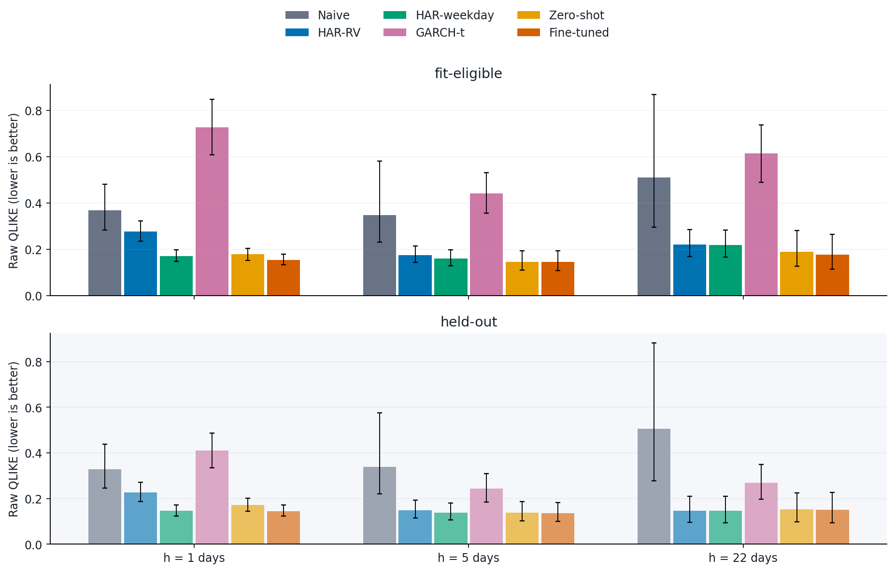
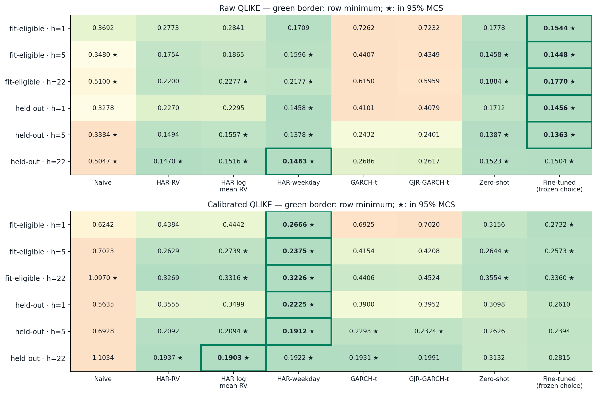
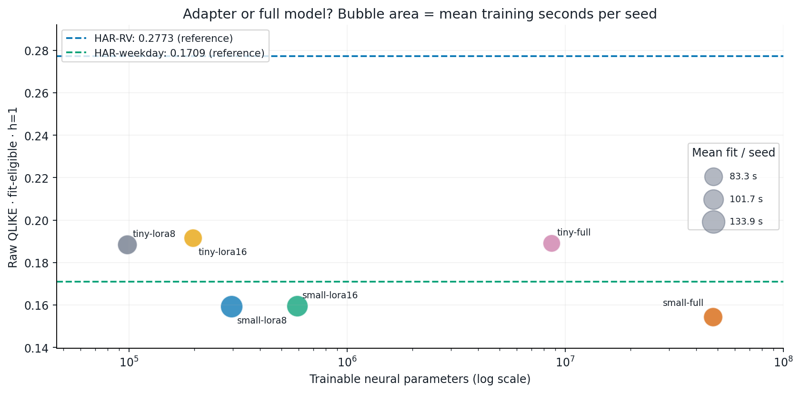
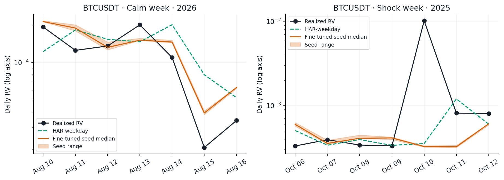
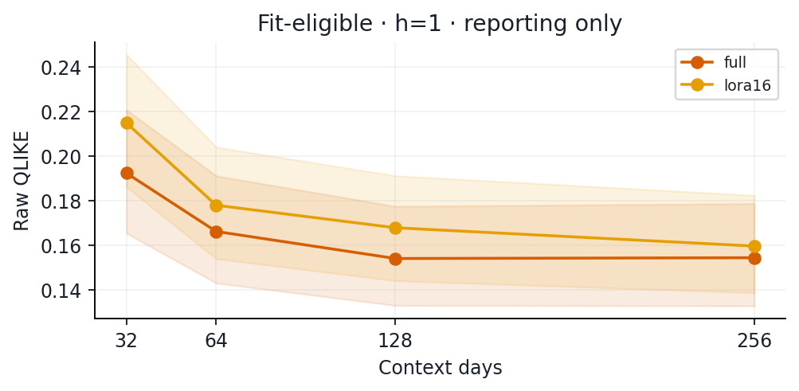
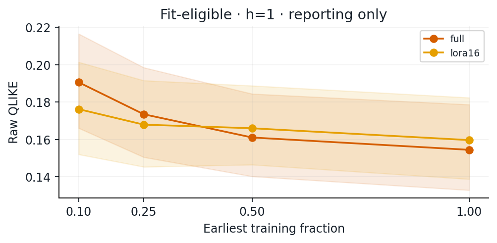
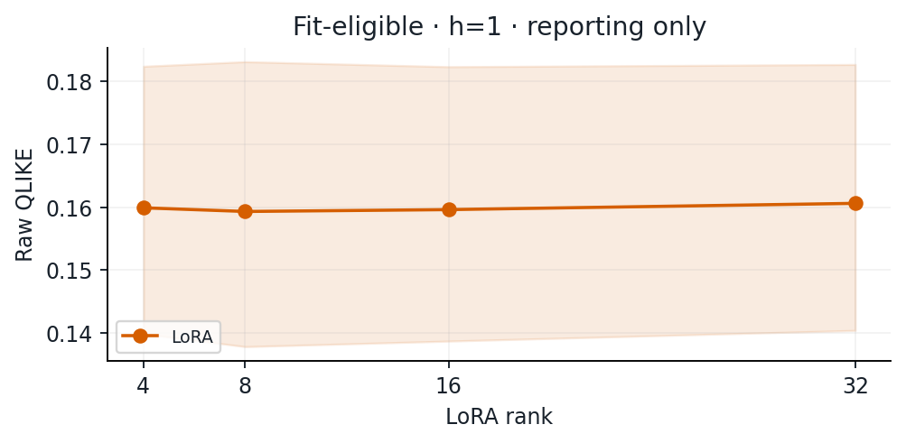
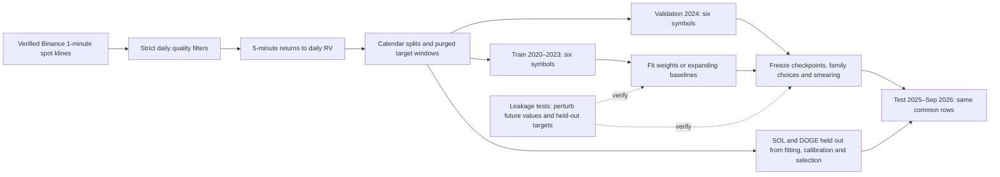

# Chronos, meet the calendar

Fine-tuning a time-series foundation model to forecast crypto volatility. The cheap baseline gets a vote.

   

## Overview: What is this project?

Predicting cryptocurrency volatility—the intensity of price swings—is critical for risk management, exchange margin requirements, and derivative pricing. For decades, quantitative finance has relied on classical econometric models like **HAR-RV** (Heterogeneous Autoregressive model of Realized Volatility) and **GARCH**.

This project investigates a central question in modern quantitative machine learning:
> **Can pretrained Time-Series Foundation Models (Amazon Chronos-Bolt) beat classical financial econometrics when forecasting cryptocurrency realized volatility?**

### What was built
- **End-to-End Pipeline**: Processes 6+ years (2020–2026) of verified 1-minute Binance spot data across 8 major crypto assets (BTC, ETH, BNB, SOL, XRP, ADA, DOGE, LTC) to construct high-frequency 5-minute realized variance (RV).
- **Zero Lookahead Leakage**: Strict expanding walk-forward splits, calendar boundary purging, and automated perturbation unit tests.
- **Foundation Models vs. Econometrics**: Evaluates zero-shot Chronos-Bolt, full fine-tuning, and Parameter-Efficient LoRA (ranks 4–32) against HAR-RV, calendar-aware HAR-weekday, and Student-t GARCH/GJR-GARCH.
- **Consumer Hardware Budget**: Engineered to run entirely on a single laptop GPU (NVIDIA RTX 3050 6 GB, 24 GB RAM) within a strict 2-hour budget.
- **Reproducible & Audited**: One-command rebuild (`python scripts/reproduce.py`), cryptographic preservation hashes, and open-source MIT release.

### High-level takeaways (Patton 2011 standard evaluation)
1. **The Calendar Baseline (HAR-weekday) Wins on RMSE & Multi-Metric Evaluation**: HAR-weekday achieves the lowest log RMSE across all 6 horizon/group combinations and lowest raw Patton QLIKE on all fit-eligible horizons. On MAE, HAR-weekday wins on all held-out horizons and fit-eligible h=1 (0.4369), while Chronos models achieve lower MAE on fit-eligible h=5 (Zero-shot 0.4303, Fine-tuned 0.4365 vs HAR-weekday 0.4402) and h=22 (Fine-tuned 0.5068 vs HAR-weekday 0.5299). On held-out raw QLIKE, GARCH-t achieves the lowest values. A simple 10-parameter linear regression beats or matches the 48M-parameter foundation model across headline metrics at a fraction of the compute cost.
2. **Calibrated Chronos Competes at Multi-Day Horizons on Full Sample**: When smearing calibration is applied to align variance scales with the conditional arithmetic mean, fine-tuned Chronos-Bolt achieves slightly lower point estimates on the full sample at h=5 (0.3697 vs 0.3799) and h=22 (0.3205 vs 0.3491); however, Diebold-Mariano tests against HAR-weekday show p-values of 0.31–0.65 (fail to reject the null of equal predictive accuracy). Full-sample results remain primary; in a post-hoc ex-shock sensitivity check, HAR-weekday ranks first across all horizons.
3. **Directional Accuracy (MDA)**: Chronos leads on fit-eligible h=5 (71.38% vs 68.82%) and h=22 (75.68% vs 71.58%), and held-out h=1 (69.07% vs 68.57%) and h=5 (72.06% vs 69.32%). However, HAR-weekday beats Chronos on held-out h=22 (78.20% vs 77.23%) and is virtually tied at fit-eligible h=1 (70.04% vs 70.42%).
4. **Typical Days (MdAPE)**: On median percentage error (which is robust to single-day extreme shocks), Chronos yields lower typical errors (31–36% MdAPE vs 37–46% for HAR).

---

## The 30-second story

At h=1, HAR-weekday wins on raw Patton QLIKE (0.4383 vs 0.5059 for fine-tuned), MAE (0.4369 vs 0.4429), and log RMSE (0.5920 vs 0.6087).
On calibrated QLIKE, smearing aligns Chronos with the conditional arithmetic mean, putting fine-tuned Chronos (0.3802) roughly tied with HAR-weekday (0.3758; DM p=0.6471).
At multi-day horizons (h=5 and h=22), calibrated Chronos achieves slightly lower point estimates (0.3205 vs 0.3491 at h=22) and lower MAE on fit-eligible symbols, but differences are not statistically distinguishable from HAR-weekday (DM p=0.31–0.58).
Full-sample results remain primary; post-hoc ex-shock evaluation confirms that over 45–50% of test-period calibrated QLIKE occurred on just three days during the October 2025 flash crash.
This is a forecasting-accuracy study, not a trading strategy.



**Headline Results Table: Patton (2011) QLIKE, Error Metrics, Uncertainty, and Costs.**
Lower QLIKE and RMSE are better. Intervals use 30-day circular blocks; fine-tuned intervals also resample seeds. Zero-shot is Chronos-Bolt-small. Fine-tuned model is validation-selected (full for h=1/5, LoRA-16 for h=22). Log RMSE, MAE, and Calibrated Patton QLIKE are the primary headline metrics.

<!-- headline-table-start -->
| Group | h | Model | log RMSE | MAE | Cal Patton QLIKE [95% CI] | Raw Patton QLIKE* | DM p vs Weekday | Params | Train Time |
| --- | ---: | --- | ---: | ---: | --- | ---: | ---: | ---: | ---: |
| fit-eligible | 1 | Naive | 0.7655 | 0.5661 | 0.4491 [0.2575, 0.9290] | 0.5634 | 0.0047 | 0 | 0.00s |
| fit-eligible | 1 | HAR-RV | 0.6833 | 0.4949 | 0.4180 [0.2073, 0.9663] | 0.4989 | <0.0001 | 4 | 0.30s |
| fit-eligible | 1 | HAR-weekday | 0.5920 | 0.4369 | 0.3758 [0.1682, 0.9177] | 0.4383 | — | 10 | 0.58s |
| fit-eligible | 1 | GARCH-t | 0.9176 | 0.7180 | 0.5020 [0.2775, 1.0706] | 0.5014 | <0.0001 | 4 | 4.53s |
| fit-eligible | 1 | Zero-shot | 0.6151 | 0.4534 | 0.4005 [0.1880, 0.9504] | 0.4921 | <0.0001 | 0 | 0.84s |
| fit-eligible | 1 | Fine-tuned | 0.6087 | 0.4429 | 0.3802 [0.1802, 0.8886] | 0.5059 | 0.6471 | 47.7M | 99.26s |
| fit-eligible | 5 | Naive | 0.8338 | 0.6041 | 0.4965 [0.3080, 0.8632] | 0.7517 | 0.0268 | 0 | 0.00s |
| fit-eligible | 5 | HAR-RV | 0.6290 | 0.4606 | 0.3867 [0.1646, 0.8581] | 0.4363 | 0.5651 | 4 | 0.30s |
| fit-eligible | 5 | HAR-weekday | 0.6090 | 0.4402 | 0.3799 [0.1539, 0.8658] | 0.4276 | — | 10 | 0.58s |
| fit-eligible | 5 | GARCH-t | 0.8193 | 0.6627 | 0.4474 [0.2203, 0.9260] | 0.4463 | 0.0006 | 4 | 4.53s |
| fit-eligible | 5 | Zero-shot | 0.6315 | 0.4303 | 0.3809 [0.1639, 0.8380] | 0.5262 | 0.9563 | 0 | 0.84s |
| fit-eligible | 5 | Fine-tuned | 0.6359 | 0.4365 | 0.3697 [0.1625, 0.8249] | 0.5369 | 0.5834 | 47.7M | 99.26s |
| fit-eligible | 22 | Naive | 0.9834 | 0.7215 | 0.5766 [0.3792, 0.9175] | 1.0540 | <0.0001 | 0 | 0.00s |
| fit-eligible | 22 | HAR-RV | 0.6865 | 0.5321 | 0.3501 [0.1744, 0.6891] | 0.3865 | 0.2970 | 4 | 0.30s |
| fit-eligible | 22 | HAR-weekday | 0.6843 | 0.5299 | 0.3491 [0.1724, 0.6888] | 0.3853 | — | 10 | 0.58s |
| fit-eligible | 22 | GARCH-t | 0.9176 | 0.7620 | 0.3820 [0.2135, 0.6977] | 0.3939 | 0.0587 | 4 | 4.53s |
| fit-eligible | 22 | Zero-shot | 0.7326 | 0.5108 | 0.3530 [0.1906, 0.6507] | 0.5635 | 0.8362 | 0 | 0.84s |
| fit-eligible | 22 | Fine-tuned | 0.7158 | 0.5068 | 0.3205 [0.1772, 0.5822] | 0.5332 | 0.3136 | 589.8K | 122.62s |
| held-out | 1 | Naive | 0.7326 | 0.5455 | 0.4368 [0.2335, 0.9416] | 0.5454 | 0.0031 | 0 | 0.00s |
| held-out | 1 | HAR-RV | 0.6529 | 0.4769 | 0.4026 [0.1877, 0.9611] | 0.4927 | 0.0010 | 4 | 0.30s |
| held-out | 1 | HAR-weekday | 0.5738 | 0.4205 | 0.3702 [0.1552, 0.9140] | 0.4427 | — | 10 | 0.58s |
| held-out | 1 | GARCH-t | 0.7616 | 0.5920 | 0.4056 [0.2063, 0.9090] | 0.4031 | 0.1093 | 4 | 4.53s |
| held-out | 1 | Zero-shot | 0.6086 | 0.4425 | 0.4000 [0.1869, 0.9405] | 0.4880 | <0.0001 | 0 | 0.84s |
| held-out | 1 | Fine-tuned | 0.5957 | 0.4280 | 0.3809 [0.1735, 0.9048] | 0.5063 | 0.0797 | 47.7M | 99.26s |
| held-out | 5 | Naive | 0.8067 | 0.5868 | 0.4503 [0.2818, 0.7605] | 0.6621 | 0.1168 | 0 | 0.00s |
| held-out | 5 | HAR-RV | 0.6091 | 0.4384 | 0.3616 [0.1428, 0.8176] | 0.4263 | 0.7135 | 4 | 0.30s |
| held-out | 5 | HAR-weekday | 0.5923 | 0.4174 | 0.3573 [0.1349, 0.8296] | 0.4191 | — | 10 | 0.58s |
| held-out | 5 | GARCH-t | 0.6686 | 0.5242 | 0.3539 [0.1506, 0.7631] | 0.3500 | 0.9041 | 4 | 4.53s |
| held-out | 5 | Zero-shot | 0.6179 | 0.4213 | 0.3545 [0.1617, 0.7125] | 0.4767 | 0.9347 | 0 | 0.84s |
| held-out | 5 | Fine-tuned | 0.6201 | 0.4259 | 0.3423 [0.1510, 0.7490] | 0.4980 | 0.4903 | 47.7M | 99.26s |
| held-out | 22 | Naive | 0.9462 | 0.6997 | 0.5163 [0.3474, 0.7795] | 0.9123 | <0.0001 | 0 | 0.00s |
| held-out | 22 | HAR-RV | 0.6079 | 0.4367 | 0.2717 [0.1176, 0.5578] | 0.3297 | 0.8689 | 4 | 0.30s |
| held-out | 22 | HAR-weekday | 0.6071 | 0.4355 | 0.2719 [0.1165, 0.5584] | 0.3295 | — | 10 | 0.58s |
| held-out | 22 | GARCH-t | 0.6787 | 0.5475 | 0.2800 [0.1164, 0.5758] | 0.2664 | 0.6075 | 4 | 4.53s |
| held-out | 22 | Zero-shot | 0.6538 | 0.4550 | 0.2755 [0.1706, 0.4439] | 0.4040 | 0.9415 | 0 | 0.84s |
| held-out | 22 | Fine-tuned | 0.6526 | 0.4629 | 0.2570 [0.1385, 0.4599] | 0.4201 | 0.6794 | 589.8K | 122.62s |
<!-- headline-table-end -->

\* Note: Raw QLIKE is reported as a secondary column; without smearing calibration to align variance scales with the conditional arithmetic mean, raw Patton QLIKE rewards upward-biased forecasts (e.g., GARCH on held-out assets). Log RMSE, MAE, and Calibrated Patton QLIKE are the primary headline metrics.

Sources: [Stage 7 headline CSV](results/stage7_headline.csv), [baselines](results/stage7_baselines.csv),
[zero-shot](results/stage7_zero_shot.csv), [fine-tuning](results/stage7_finetune.csv).

### Post-Hoc Ex-Shock Sensitivity Analysis (Purging October 10–12 Flash Crash Windows)

> [!NOTE]
> **Post-hoc sensitivity analysis**: This exclusion window was chosen after inspecting the worst test-period forecasts (the October 10 flash crash); no multiplicity adjustments are applied. **The full-sample results above remain primary.**

To evaluate sensitivity to tail outliers, the table below re-evaluates all models after purging the October 10–12, 2025 flash crash and any overlapping multi-day target windows ($h=5, 22$).
Models, validation choices, and calibration smearing factors remain frozen.

| Group | h | Model | log RMSE (Ex) | MAE (Ex) | Raw Patton (Ex) | Cal Patton (Ex) | DM p vs Weekday | MCS 95% |
| --- | ---: | --- | ---: | ---: | ---: | ---: | ---: | :---: |
| fit-eligible | 1 | Naive | 0.7347 | 0.5564 | 0.3215 | 0.2846 | <0.0001 | ✗ |
| fit-eligible | 1 | HAR-RV | 0.6577 | 0.4883 | 0.2400 | 0.2286 | <0.0001 | ✗ |
| fit-eligible | 1 | HAR-weekday | 0.5636 | 0.4308 | 0.1944 | 0.1891 | — | ✓ |
| fit-eligible | 1 | GARCH-t | 0.9029 | 0.7137 | 0.3096 | 0.3044 | <0.0001 | ✗ |
| fit-eligible | 1 | Zero-shot | 0.5851 | 0.4459 | 0.2193 | 0.2098 | <0.0001 | ✗ |
| fit-eligible | 1 | Fine-tuned | 0.5781 | 0.4352 | 0.2373 | 0.2018 | 0.0058 | ✗ |
| fit-eligible | 5 | Naive | 0.7716 | 0.5797 | 0.4914 | 0.3568 | <0.0001 | ✗ |
| fit-eligible | 5 | HAR-RV | 0.5620 | 0.4405 | 0.1951 | 0.1982 | 0.0001 | ✗ |
| fit-eligible | 5 | HAR-weekday | 0.5387 | 0.4193 | 0.1835 | 0.1870 | — | ✓ |
| fit-eligible | 5 | GARCH-t | 0.7795 | 0.6468 | 0.2601 | 0.2548 | <0.0001 | ✗ |
| fit-eligible | 5 | Zero-shot | 0.5566 | 0.4078 | 0.2427 | 0.2047 | 0.0466 | ✓ |
| fit-eligible | 5 | Fine-tuned | 0.5606 | 0.4138 | 0.2477 | 0.1966 | 0.0987 | ✓ |
| fit-eligible | 22 | Naive | 0.8642 | 0.6578 | 0.6448 | 0.4116 | <0.0001 | ✗ |
| fit-eligible | 22 | HAR-RV | 0.5745 | 0.4830 | 0.1644 | 0.1878 | 0.0002 | ✗ |
| fit-eligible | 22 | HAR-weekday | 0.5716 | 0.4804 | 0.1630 | 0.1861 | — | ✓ |
| fit-eligible | 22 | GARCH-t | 0.8777 | 0.7390 | 0.2793 | 0.2321 | 0.0005 | ✗ |
| fit-eligible | 22 | Zero-shot | 0.5893 | 0.4470 | 0.2456 | 0.2065 | 0.1086 | ✓ |
| fit-eligible | 22 | Fine-tuned | 0.5770 | 0.4456 | 0.2321 | 0.1911 | 0.5205 | ✓ |
| held-out | 1 | Naive | 0.7012 | 0.5361 | 0.2886 | 0.2621 | <0.0001 | ✗ |
| held-out | 1 | HAR-RV | 0.6269 | 0.4707 | 0.2283 | 0.2092 | 0.0021 | ✗ |
| held-out | 1 | HAR-weekday | 0.5450 | 0.4144 | 0.1945 | 0.1802 | — | ✓ |
| held-out | 1 | GARCH-t | 0.7445 | 0.5878 | 0.2347 | 0.2322 | 0.0004 | ✗ |
| held-out | 1 | Zero-shot | 0.5792 | 0.4351 | 0.2186 | 0.2118 | <0.0001 | ✗ |
| held-out | 1 | Fine-tuned | 0.5646 | 0.4202 | 0.2253 | 0.1942 | 0.0048 | ✗ |
| held-out | 5 | Naive | 0.7475 | 0.5638 | 0.4392 | 0.3312 | <0.0001 | ✗ |
| held-out | 5 | HAR-RV | 0.5436 | 0.4190 | 0.2003 | 0.1851 | 0.0155 | ✓ |
| held-out | 5 | HAR-weekday | 0.5240 | 0.3977 | 0.1910 | 0.1770 | — | ✓ |
| held-out | 5 | GARCH-t | 0.6211 | 0.5076 | 0.1889 | 0.1872 | 0.6118 | ✓ |
| held-out | 5 | Zero-shot | 0.5500 | 0.4001 | 0.2427 | 0.2103 | 0.0020 | ✓ |
| held-out | 5 | Fine-tuned | 0.5487 | 0.4042 | 0.2343 | 0.1848 | 0.3285 | ✓ |
| held-out | 22 | Naive | 0.8418 | 0.6447 | 0.5918 | 0.3896 | <0.0001 | ✗ |
| held-out | 22 | HAR-RV | 0.4913 | 0.3888 | 0.1407 | 0.1334 | 0.1375 | ✓ |
| held-out | 22 | HAR-weekday | 0.4898 | 0.3872 | 0.1399 | 0.1327 | — | ✓ |
| held-out | 22 | GARCH-t | 0.6142 | 0.5177 | 0.1562 | 0.1372 | 0.7768 | ✓ |
| held-out | 22 | Zero-shot | 0.5429 | 0.4045 | 0.2114 | 0.1935 | 0.0004 | ✗ |
| held-out | 22 | Fine-tuned | 0.5245 | 0.4086 | 0.1822 | 0.1572 | 0.1229 | ✓ |

Source: [Stage 7 ex-shock CSV](results/stage7_ex_shock.csv).

### Paired Loss Differences (Fine-tuned minus HAR-weekday)

Mean difference in calibrated Patton QLIKE ($d_t = L_{\text{FT}, t} - L_{\text{Weekday}, t}$), 95% circular block-bootstrap confidence intervals (30-day blocks, 1,000 replications), and Diebold-Mariano test statistics. Negative values favor Fine-tuned Chronos; positive values favor HAR-weekday.

On fit-eligible $h=1$, the full-sample gap is +0.0044 but ex-shock is +0.0127, i.e. the fine-tuned model lost less than HAR-weekday on the shock dates; this is a single event.

| Group | h | Sample | n | Mean Diff (FT − Weekday) | 95% Bootstrap CI | DM stat | DM p-val |
| --- | ---: | --- | ---: | ---: | --- | ---: | ---: |
| fit-eligible | 1 | full-sample | 638 | +0.0044 | [-0.0202, +0.0196] | +0.458 | 0.6471 |
| fit-eligible | 1 | ex-shock | 635 | +0.0127 | [+0.0045, +0.0210] | +2.769 | 0.0058 |
| fit-eligible | 5 | full-sample | 634 | -0.0102 | [-0.0571, +0.0189] | -0.549 | 0.5834 |
| fit-eligible | 5 | ex-shock | 627 | +0.0096 | [-0.0017, +0.0202] | +1.654 | 0.0987 |
| fit-eligible | 22 | full-sample | 617 | -0.0286 | [-0.0965, +0.0135] | -1.009 | 0.3136 |
| fit-eligible | 22 | ex-shock | 593 | +0.0050 | [-0.0105, +0.0221] | +0.643 | 0.5205 |
| held-out | 1 | full-sample | 638 | +0.0107 | [-0.0019, +0.0217] | +1.755 | 0.0797 |
| held-out | 1 | ex-shock | 635 | +0.0141 | [+0.0044, +0.0232] | +2.829 | 0.0048 |
| held-out | 5 | full-sample | 634 | -0.0151 | [-0.0673, +0.0204] | -0.690 | 0.4903 |
| held-out | 5 | ex-shock | 627 | +0.0078 | [-0.0085, +0.0236] | +0.978 | 0.3285 |
| held-out | 22 | full-sample | 617 | -0.0149 | [-0.1012, +0.0414] | -0.413 | 0.6794 |
| held-out | 22 | ex-shock | 593 | +0.0245 | [-0.0072, +0.0574] | +1.545 | 0.1229 |

Source: [Stage 7 paired differences CSV](results/stage7_paired_diff.csv).

### Shock Day Loss Concentration

Percentage of cumulative test-period QLIKE loss concentrated specifically in the removed October shock origins. Even though shock dates comprise only 0.47% to 3.89% of origin dates, they account for roughly half of all accumulated loss across models.

| Group | h | Model | Shock Dates (%) | Cal QLIKE Shock Share | Raw QLIKE Shock Share |
| --- | ---: | --- | ---: | ---: | ---: |
| fit-eligible | 1 | Naive | 3/638 (0.47%) | 36.94% | 43.19% |
| fit-eligible | 1 | HAR-RV | 3/638 (0.47%) | 45.55% | 52.12% |
| fit-eligible | 1 | HAR-weekday | 3/638 (0.47%) | 49.91% | 55.85% |
| fit-eligible | 1 | GARCH-t | 3/638 (0.47%) | 39.64% | 38.55% |
| fit-eligible | 1 | Zero-shot | 3/638 (0.47%) | 47.87% | 55.65% |
| fit-eligible | 1 | Fine-tuned | 3/638 (0.47%) | 47.17% | 53.31% |
| fit-eligible | 5 | Naive | 7/634 (1.10%) | 28.94% | 35.34% |
| fit-eligible | 5 | HAR-RV | 7/634 (1.10%) | 49.32% | 55.79% |
| fit-eligible | 5 | HAR-weekday | 7/634 (1.10%) | 51.32% | 57.55% |
| fit-eligible | 5 | GARCH-t | 7/634 (1.10%) | 43.68% | 42.36% |
| fit-eligible | 5 | Zero-shot | 7/634 (1.10%) | 46.84% | 54.37% |
| fit-eligible | 5 | Fine-tuned | 7/634 (1.10%) | 47.41% | 54.37% |
| fit-eligible | 22 | Naive | 24/617 (3.89%) | 31.39% | 41.20% |
| fit-eligible | 22 | HAR-RV | 24/617 (3.89%) | 48.45% | 59.12% |
| fit-eligible | 22 | HAR-weekday | 24/617 (3.89%) | 48.77% | 59.34% |
| fit-eligible | 22 | GARCH-t | 24/617 (3.89%) | 41.59% | 31.86% |
| fit-eligible | 22 | Zero-shot | 24/617 (3.89%) | 43.77% | 58.11% |
| fit-eligible | 22 | Fine-tuned | 24/617 (3.89%) | 42.71% | 58.16% |
| held-out | 1 | Naive | 3/638 (0.47%) | 40.28% | 47.34% |
| held-out | 1 | HAR-RV | 3/638 (0.47%) | 48.28% | 53.88% |
| held-out | 1 | HAR-weekday | 3/638 (0.47%) | 51.56% | 56.27% |
| held-out | 1 | GARCH-t | 3/638 (0.47%) | 43.02% | 42.05% |
| held-out | 1 | Zero-shot | 3/638 (0.47%) | 47.29% | 55.42% |
| held-out | 1 | Fine-tuned | 3/638 (0.47%) | 49.24% | 55.71% |
| held-out | 5 | Naive | 7/634 (1.10%) | 27.25% | 34.41% |
| held-out | 5 | HAR-RV | 7/634 (1.10%) | 49.39% | 53.53% |
| held-out | 5 | HAR-weekday | 7/634 (1.10%) | 51.00% | 54.93% |
| held-out | 5 | GARCH-t | 7/634 (1.10%) | 47.69% | 46.62% |
| held-out | 5 | Zero-shot | 7/634 (1.10%) | 41.34% | 49.66% |
| held-out | 5 | Fine-tuned | 7/634 (1.10%) | 46.60% | 53.48% |
| held-out | 22 | Naive | 24/617 (3.89%) | 27.48% | 37.65% |
| held-out | 22 | HAR-RV | 24/617 (3.89%) | 52.80% | 58.99% |
| held-out | 22 | HAR-weekday | 24/617 (3.89%) | 53.09% | 59.20% |
| held-out | 22 | GARCH-t | 24/617 (3.89%) | 52.90% | 43.66% |
| held-out | 22 | Zero-shot | 24/617 (3.89%) | 32.51% | 49.71% |
| held-out | 22 | Fine-tuned | 24/617 (3.89%) | 41.19% | 58.31% |

Source: [Stage 7 shock loss shares CSV](results/stage7_shock_loss_share.csv).

## Scoreboard



The grid includes the alternate HAR feature definition and asymmetric GARCH so their wins and losses remain visible.
Green borders mark exact point-estimate winners, including exact ties; displayed rounding is not a tie test.
Stars use the [Stage 7 joint MCS](results/stage7_mcs.csv), whose universe also includes the ablations and other original families—not just the displayed columns.
MCS membership means the procedure did not eliminate that candidate; it does not prove equivalence.

## The day everything broke

The three worst h=1 errors all land on **2025-10-10**. They are ranked by mean seed squared log error;
the forecast RV below is the exponential of the mean log forecast, shown for illustration rather than scored as an ensemble.

| Date | Symbol | Realized RV | Forecast RV |
| --- | --- | --- | --- |
| 2025-10-10 | ADAUSDT | 0.5540 | 0.0010 |
| 2025-10-10 | DOGEUSDT | 0.4332 | 0.0013 |
| 2025-10-10 | XRPUSDT | 0.1015 | 0.0005 |


The models saw daily log RV through the previous UTC day—not tomorrow's prices, order books, or news.
Binance's [retrospective statement](https://www.binance.com/en/support/announcement/detail/d9cb0d52d7c142a5be4f49732bd8760c)
describes a broad sell-off that day. That is context, not a proven causal explanation for each coin's error.
Source numbers: [worst-forecast CSV](results/stage5_worst_forecasts.csv).

### Take the shock out

Reporting-only rescore: exclude October 10 **and October 11–12**, removing every forecast whose target window intersects those dates.
For h=5/22 this removes overlapping averages too, rather than leaving pieces of the shock inside the target.
Models, validation choices and calibration factors stay frozen. No refitting, recalibration or new winner selection for the headline.
The rescore includes the scoreboard's eight columns. Later forecasts still use observed history;
this is a loss rescore, not a counterfactual market in which the shock never happened.

| Group | h | Raw Patton before | Raw Patton after | Calibrated Patton before | Calibrated Patton after | Origins removed |
| --- | --- | --- | --- | --- | --- | --- |
| fit-eligible | 1 | HAR-weekday | HAR-weekday | HAR-weekday | HAR-weekday | 3 |
| fit-eligible | 5 | HAR-weekday | HAR-weekday | Fine-tuned | HAR-weekday | 7 |
| fit-eligible | 22 | HAR-weekday | HAR-weekday | Fine-tuned | HAR-weekday | 24 |
| held-out | 1 | GARCH-t | HAR-weekday | HAR-weekday | HAR-weekday | 3 |
| held-out | 5 | GARCH-t | GARCH-t | Fine-tuned | HAR-weekday | 7 |
| held-out | 22 | GARCH-t | HAR-weekday | Fine-tuned | HAR-weekday | 24 |

Under standard Patton QLIKE, removing the flash crash dates ranks HAR-weekday first in calibrated QLIKE across all horizons and groups; difference is statistically significant at h=1 (DM p = 0.0058 fit-eligible, p = 0.0048 held-out), while at h=5 and h=22 HAR-weekday ranks first with differences not statistically significant (DM p = 0.0987 and 0.5205).
All model scores, ranks and retained counts: [robustness CSV](results/stage7_robustness.csv). This sensitivity check reports point estimates and DM paired tests without refitting.

### Beyond loss averages: directional calls and typical error

Standard QLIKE and RMSE averages are heavily weighted by tail events. Complementary scale-free metrics from [extended metrics CSV](results/stage6_extended_metrics.csv) show performance across alternative dimensions:

**Directional Accuracy (MDA, higher is better; Naive excluded as direction is undefined):**

| Group | h | HAR-RV | HAR-weekday | GARCH-t | Zero-shot | Fine-tuned |
| --- | ---: | ---: | ---: | ---: | ---: | ---: |
| fit-eligible | 1 | 64.45% | 70.04% | 59.90% | 68.47% | 70.42% |
| fit-eligible | 5 | 67.64% | 68.82% | 62.70% | 71.85% | 71.38% |
| fit-eligible | 22 | 71.77% | 71.58% | 65.96% | 74.91% | 75.68% |
| held-out | 1 | 64.26% | 68.57% | 63.32% | 67.32% | 69.07% |
| held-out | 5 | 68.93% | 69.32% | 65.30% | 71.77% | 72.06% |
| held-out | 22 | 78.04% | 78.20% | 70.58% | 77.80% | 77.23% |

**Median Absolute Percentage Error on Variance (MdAPE, lower is better):**

| Group | h | Naive | HAR-RV | HAR-weekday | GARCH-t | Zero-shot | Fine-tuned |
| --- | ---: | ---: | ---: | ---: | ---: | ---: | ---: |
| fit-eligible | 1 | 41.12% | 35.32% | 35.01% | 67.54% | 35.14% | 33.39% |
| fit-eligible | 5 | 43.72% | 38.50% | 36.70% | 70.25% | 30.88% | 31.57% |
| fit-eligible | 22 | 50.35% | 46.35% | 46.29% | 90.11% | 35.15% | 36.65% |
| held-out | 1 | 39.50% | 35.31% | 33.52% | 52.82% | 34.02% | 32.52% |
| held-out | 5 | 43.53% | 35.01% | 33.80% | 50.98% | 31.40% | 30.50% |
| held-out | 22 | 49.37% | 32.82% | 32.65% | 53.04% | 31.91% | 31.89% |

- **Directional hit rate (MDA):** Chronos models achieve higher directional accuracy on fit-eligible h=5 (71.38% vs 68.82%) and h=22 (75.68% vs 71.58%), and held-out h=1 (69.07% vs 68.57%) and h=5 (72.06% vs 69.32%). However, **HAR-weekday beats Chronos on held-out h=22** (78.20% vs 77.23% for Fine-tuned and 77.80% for Zero-shot). At h=1 on fit-eligible assets, HAR-weekday reaches 70.04%, within 0.38% of Fine-tuned Chronos (70.42%) and outperforming Zero-shot (68.47%).
- **Typical-day error (MdAPE):** On Median Absolute Percentage Error (MdAPE), Chronos-Bolt yields lower median percentage error across all horizons (33.39% vs 35.01% at h=1; 31.57% vs 36.70% at h=5; 36.65% vs 46.29% at h=22).

## Errata: Loss Function Orientation (Patton 2011 vs Legacy)

In Stages 2–6, the evaluation suite implemented QLIKE as:
$$\mathcal{L}_{\text{legacy}}(V, \hat{V}) = \frac{\hat{V}}{V} - \log\left(\frac{\hat{V}}{V}\right) - 1 \quad (\text{forecast over actual})$$

### The Orientation Problem and Mathematical Consequence
In the time-series econometrics literature (Patton 2011, *Journal of Econometrics*), the standard robust QLIKE loss function is defined with actual over forecast:
$$\mathcal{L}_{\text{patton}}(V, \hat{V}) = \frac{V}{\hat{V}} - \log\left(\frac{V}{\hat{V}}\right) - 1 \quad (\text{actual over forecast})$$

The distinction is mathematically fundamental:
1. **Consistency for the Conditional Arithmetic Mean**:
   Taking the first-order condition of expected loss with respect to $\hat{V}$:
   $$\frac{\partial \mathcal{L}_{\text{patton}}}{\partial \hat{V}} = -\frac{V}{\hat{V}^2} + \frac{1}{\hat{V}} = \frac{\hat{V} - V}{\hat{V}^2} \implies \mathbb{E}\left[\frac{\partial \mathcal{L}_{\text{patton}}}{\partial \hat{V}}\right] = 0 \iff \hat{V} = \mathbb{E}[V]$$
   Thus, standard Patton QLIKE is strictly consistent for the **arithmetic conditional mean**.
2. **Why Legacy QLIKE Favored Negative Bias**:
   Taking the first-order condition for the legacy formula:
   $$\frac{\partial \mathcal{L}_{\text{legacy}}}{\partial \hat{V}} = \frac{1}{V} - \frac{1}{\hat{V}} \implies \mathbb{E}\left[\frac{\partial \mathcal{L}_{\text{legacy}}}{\partial \hat{V}}\right] = 0 \iff \hat{V} = \frac{1}{\mathbb{E}[1/V]}$$
   The legacy loss function is minimized at the **conditional harmonic mean** of realized variance.
   Because the harmonic mean is strictly less than or equal to the arithmetic mean ($\text{HM} \le \text{AM}$), the legacy formula penalized forecasts higher than actual linearly in $\hat{V}/V$ while penalizing under-prediction only logarithmically. This systematically rewarded models that under-forecasted volatility (negative bias).
   Under standard Patton QLIKE, under-prediction ($V > \hat{V}$) is penalized **linearly in the ratio $V/\hat{V}$** (as $V/\hat{V} \to \infty$, $\mathcal{L} \approx V/\hat{V}$), while over-prediction grows only logarithmically ($\log(\hat{V}/V)$).
3. **What Changed Under Patton (2011) QLIKE**:
   - Because raw Chronos-Bolt forecasts had a slight negative bias (bias $\approx -0.09$), legacy QLIKE artificially boosted raw Chronos-Bolt below HAR-RV and HAR-weekday.
   - When smearing calibration was applied (multiplying by $\mathbb{E}[\exp(e)] > 1$ to align with the arithmetic mean), legacy QLIKE penalized that upward scale adjustment.
   - Under standard Patton QLIKE, smearing calibration now functions exactly as econometrics theory predicts: it scales forecasts to the arithmetic mean, cutting loss from ~0.50 down to ~0.38.
   - Under standard Patton QLIKE, **HAR-weekday achieves the lowest log RMSE across all horizons and groups, and lowest raw QLIKE on all fit-eligible horizons**. On calibrated loss, fine-tuned Chronos-Bolt achieves slightly lower point estimates at $h=5$ and $h=22$ (e.g. 0.3205 vs 0.3491 at $h=22$), but Diebold-Mariano tests vs HAR-weekday confirm the difference is not statistically significant ($p \approx 0.31\text{--}0.65$). On ex-shock evaluation, HAR-weekday ranks first across all horizons and groups.

### HAC Bandwidth and Extreme Diebold-Mariano p-values

The Diebold-Mariano implementation uses Newey-West / Bartlett HAC covariance estimation with bandwidth $\min(N-1, \max(h-1, \lfloor 4(N/100)^{2/9} \rfloor))$, yielding 6 lags for $h=1$ and $h=5$ ($N=638$), and 21 lags for $h=22$.
Several baseline comparisons vs HAR-weekday produce extreme p-values ($< 10^{-9}$), including fit-eligible $h=1$ GARCH-t ($p = 3.87 \times 10^{-14}$) and HAR-RV ($p = 2.45 \times 10^{-10}$), and held-out $h=1$ Zero-shot ($p = 6.90 \times 10^{-11}$).

**Are these extreme p-values driven by the shock days?**
No. When re-estimated on the ex-shock sample (purging October 10–12), these p-values remain equally or more extreme (GARCH-t $p = 1.47 \times 10^{-18}$, HAR-RV $p = 7.10 \times 10^{-10}$, Zero-shot $p = 5.90 \times 10^{-15}$). Purging the flash crash reduces the sample variance of the loss differential $\text{Var}(d_t)$ without closing the gap, which is consistent with a weekday effect; not separately tested. This gap relates to day-of-week volatility seasonality rather than single-event flash-crash leverage.

### Appendix: Legacy Orientation QLIKE Numbers (Stages 2–6)
For historical auditability and full reproducibility of earlier milestones, the legacy orientation QLIKE values ($\hat{V}/V - \log(\hat{V}/V) - 1$) are preserved below:

<!-- legacy-headline-start -->
| Group | h | Naive | HAR-RV | HAR-weekday | GARCH-t | Zero-shot | Fine-tuned |
| --- | ---: | ---: | ---: | ---: | ---: | ---: | ---: |
| fit-eligible | 1 | 0.3692 | 0.2773 | 0.1709 | 0.7262 | 0.1778 | 0.1544 |
| fit-eligible | 5 | 0.3480 | 0.1754 | 0.1596 | 0.4407 | 0.1458 | 0.1448 |
| fit-eligible | 22 | 0.5100 | 0.2200 | 0.2177 | 0.6150 | 0.1884 | 0.1770 |
| held-out | 1 | 0.3278 | 0.2270 | 0.1458 | 0.4101 | 0.1712 | 0.1456 |
| held-out | 5 | 0.3384 | 0.1494 | 0.1378 | 0.2432 | 0.1387 | 0.1363 |
| held-out | 22 | 0.5047 | 0.1470 | 0.1463 | 0.2686 | 0.1523 | 0.1504 |
<!-- legacy-headline-end -->

Sources: [Stage 2 baselines](results/stage2_baselines.csv), [Stage 3 zero-shot](results/stage3_zero_shot.csv),
[Stage 4 fine-tuning](results/stage4_finetune.csv), [Stage 5 weekday](results/stage5_weekday.csv).

## Is it worth the compute?



The chart shows the original full/LoRA families at h=1 on fit-eligible symbols. Bubble area is mean training seconds per seed.
HAR reference lines sit outside the neural-parameter axis: **zero neural parameters does not mean zero fitted coefficients**—HAR-RV fits four and HAR-weekday ten per horizon.
Zero-shot also has zero trainable parameters and is therefore not placed at a fictitious positive value on a log axis.
Parameter-efficient adaptation saves trainable weights; it does not guarantee a better forecast.
[Costs and uncertainty](results/stage4_finetune.csv).



These are rolling h=1 forecasts, not a seven-day forecast issued at the week's start.
The calm panel is the lowest-mean-RV complete Monday–Sunday BTC week in test; the shock panel is the week containing October 10.
Both are retrospective illustrations, never selection inputs. The fine-tuned line is the median across seed-specific median forecasts;
the shaded seed range is **not** a predictive interval. Variance forecasts are raw, without smearing.
[Figure inputs](results/stage6_forecast_weeks.csv).

## What actually mattered



Short context hurt: 32 days loses to 256 at h=1 in both modes and both symbol groups.



More history helped next-day raw QLIKE overall, but calibrated and longer-horizon scores were not uniformly monotone.



Rank had no clear accuracy effect in this sweep; buying more adapter parameters did not buy a reliable win.

Small panels show fit-eligible h=1 and 95% block/seed intervals. Full contexts/fractions/ranks, all horizons/groups:
[ablation results](results/stage5_ablation_summary.csv). Context experiments keep target-window membership fixed;
fractions take the earliest windows by origin date, with deterministic symbol tie breaks.
These test curves are reporting only. Ten new small-model runs selected the three-epoch cap, so the sweep does not establish convergence.

## Things that didn't work

- **Long-horizon dominance.** At h=22, calibrated QLIKE favors HAR variants over the frozen fine-tuned model in both groups.
- **More rank, more accuracy.** Ranks 4–32 show little raw-QLIKE separation; this is a null result at this budget, not proof ranks never matter.
- **Calibration as a free upgrade.** Validation smearing hurts HAR's test QLIKE. It is frozen and reported beside raw scores, not switched off after seeing test.
- **Extra epochs.** The separately approved tiny LoRA16 extension selected epochs 1/3/2, never beyond the old cap; it did not unlock a better checkpoint.
- **Tiny context.** The 32-day context damages next-day performance.

The [extended experiment](results/stage5_extended_tiny_summary.csv) remains separate. Shared-epoch validation losses show small numerical drift
with identical cached tensor values but different memory layout; [audit](results/stage5_extended_reproducibility.csv).
Neither this experiment nor any ablation replaces a Stage 4 number.

## How we tried not to cheat



- Targets crossing split boundaries are purged. Horizons mean **log of arithmetic mean daily RV**, not an average of logs.
- Daily RV sums squared five-minute log returns from verified one-minute UTC klines; incomplete or bad days are dropped, never filled.
- Fit-eligible symbols are BTC, ETH, BNB, XRP, ADA and LTC; the held-out pair is SOL and DOGE (all USDT spot pairs).
- SOL/DOGE never enter model fitting, checkpoint/family selection or smearing calibration. Their past series may be forecast inputs.
- Fine-tuned weights freeze before test. Econometric models expand their six-symbol fit and refit every 30 days, using only then-observed targets.
- Each model/horizon's smearing factor is `mean(exp(target - prediction))` on six-symbol 2024 validation residuals, then frozen. Raw uses factor one.
- Median daily log-RV paths become horizon forecasts via `log(mean(exp(path[:h])))`; contexts end at the origin, preserving missing days as NaNs/masks.
- Future-perturbation and held-out-perturbation tests protect contexts and fitting. Missing forecasts cannot silently shrink the common panel.
- [Preservation hashes](results/stage7_preservation.csv) verify every pre-Stage-7 result file byte-identical. [Stage 5 audit](results/stage5_panel_audit.csv) checks common rows and exact reuse.
- Regime thresholds use training data only. [Regime results](results/stage7_regimes.csv) retain calendar gaps in resampling and report sparse-sample counts.

## FAQ for skeptics

**Why not just use HAR?** You might. HAR-weekday is a strong cheap benchmark; fine-tuning's clearest advantage is against the original HAR-RV, not every HAR variant.

**Is GARCH a straw man?** It uses pooled Student-t GARCH/GJR likelihoods, strict close-to-close returns, and the same walk-forward schedule. But return variance is a proxy for intraday RV, and shared cross-symbol parameters constrain it. This is not a verdict on all GARCH specifications.

**Does this make money?** That was not tested. There are no strategy returns, execution model, fees, slippage or profitability claims here.

**Could Chronos have seen this data in pretraining?** Possibly; overlap is unaudited. Local leakage controls cannot establish pretraining independence.

**Why only three seeds?** Laptop budget. Seed resampling reflects the observed runs, not the entire distribution of training randomness.

## Limitations

- Pooled GARCH uses a daily-return variance proxy; missing-return state updates are an expected-state approximation.
- Strict day dropping trades coverage for quality and can change which regimes remain.
- Validation is reused for early stopping, family selection and calibration; it is not independent generalization evidence.
- Three seeds only; limited epochs and multiple descriptive comparisons.
- Unaudited pretraining overlap.
- One crypto venue, spot data only. No cross-venue or asset-class generalization claim.
- A few regimes and shocks strongly influence the test period; removing one event is not a cure.
- The two-hour end-to-end target is not established by partial compute timings. Cold downloads, preparation and evaluation add work.

## Repo map

- `src/data.py`, `src/baselines.py`, `src/finetune.py`, `src/evaluate.py`: data, models and one shared scoring rule.
- `src/zero_shot.py`, `src/ablations.py`, `src/regimes.py`: causal contexts and analysis.
- `configs/`: fixed experiment settings and pinned model revisions.
- `results/`: immutable historical CSVs/figures plus new Stage 7 reporting CSVs.
- `scripts/make_readme_figures.py`: every new report figure from committed CSVs; `docs/img/`: generated PNGs and local badges.
- `tests/`: leakage, metrics, training safeguards and README/CSV/link checks.
- `data/`: ignored caches and checkpoints. Never committed.

## How to rerun

Use Python in the range shown above and install the pinned extras:

```powershell
python -m pip install -e ".[test,zero-shot,finetune,analysis]"
python scripts/reproduce.py
```

The default is a **CSV-only report rebuild**: no raw-data download, inference or training.
`python scripts/make_readme_figures.py` regenerates all new figures by itself; the three existing error plots stay untouched.
`python scripts/reproduce.py --rescore` additionally rebuilds the small Stage 7 exports from existing `data/stage5/scored.parquet`.
`python scripts/reproduce.py --experiments` runs the complete experiment pipeline in a separate ignored workspace, preserving published results; this is expensive and opt-in.
Install a CUDA-compatible PyTorch build to use the GPU; otherwise inference/training falls back to CPU.
Check with `python -m pytest -q`. No API key is required for public Binance archives or the pinned public model weights.

### The laptop bill

Recorded on the RTX 3050 laptop; CPU stages are identified. These components are not additive end-to-end wall times.
Missing timings are marked, not guessed. Stage 6 reports a local report-generation measurement when available.

| stage | Measured minutes | component | hardware |
| --- | --- | --- | --- |
| 1 | not recorded | Not instrumented; download depends on network/cache | CPU / network |
| 2 | 0.199 | Recorded fitting + inference only | CPU |
| 3 | 0.366 | Cached model load + inference only | RTX 3050 |
| 4 | 31.711 | Training, all 18 runs | RTX 3050 |
| 5 | 65.319 | Training, 45 new runs; 9 reused | RTX 3050 |
| 6 | 0.117 | Measured CSV-only figure + README build; excludes rescore | CPU |

Source: [runtime CSV](results/stage6_runtime.csv), derived from the original per-stage cost CSVs. Timing excludes different overheads by stage;
historical GPU allocations exclude driver memory and other applications.

## Credit where due

Built on [Amazon Chronos](https://github.com/amazon-science/chronos-forecasting) and verified public [Binance market-data archives](https://data.binance.vision/).
See [CITATION.cff](CITATION.cff) for project attribution and the upstream Chronos reference. Upstream models and market data retain their own terms.

## License

Project code and original documentation: [MIT](LICENSE). The license does not relicense third-party model weights or Binance data.
