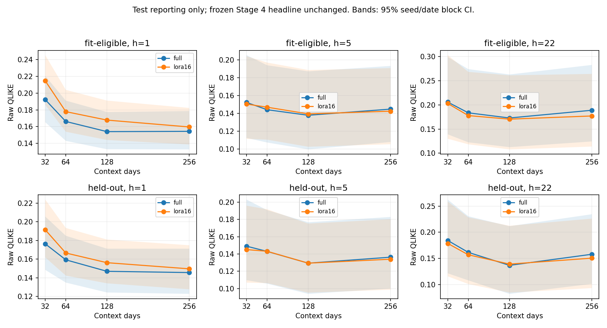
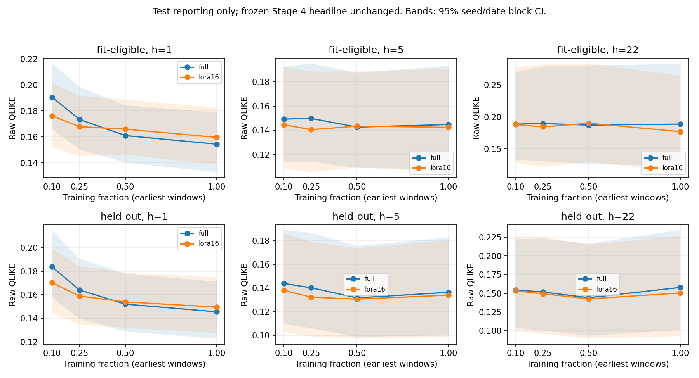
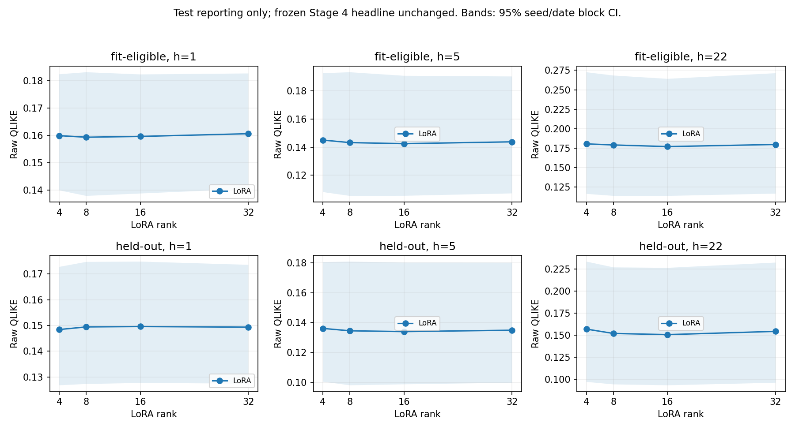
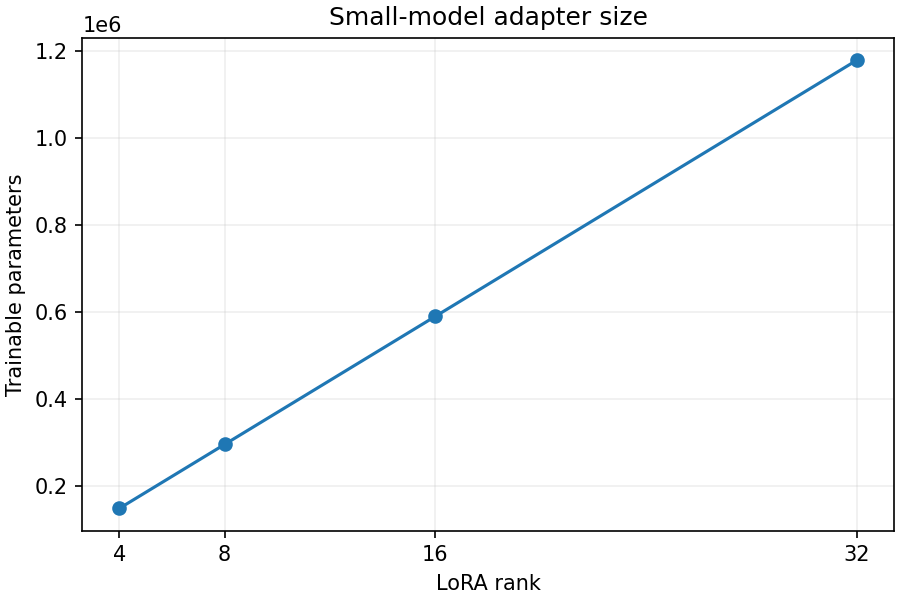
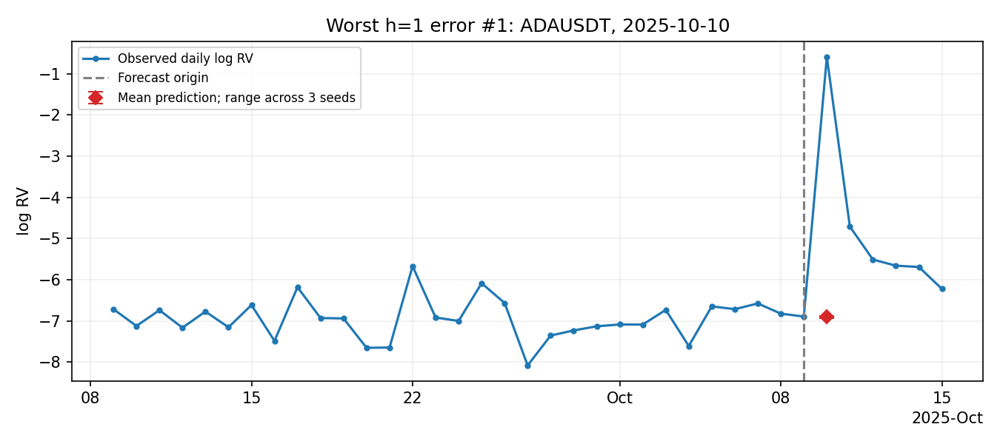
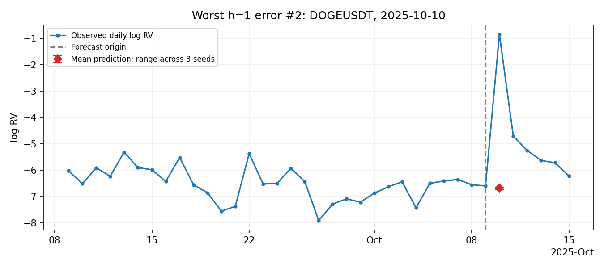
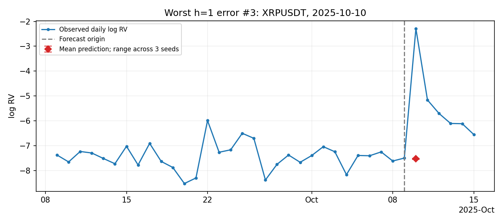

# Chronos-Bolt realized-volatility forecasting

<!-- stage3-results-start -->

Mean test results; lower is better. QLIKE C = validation-smearing calibrated. All 95% CIs, DM tests and costs are in the [results CSV](results/stage2_baselines.csv); use the [joint MCS table](results/stage3_mcs.csv) for seven-model membership.

| Group | h | Model | RMSE | MAE | QLIKE raw | QLIKE C |
|---|---:|---|---:|---:|---:|---:|
| fit-eligible | 1 | Chronos-Bolt-small | 0.6151 | 0.4534 | 0.1778 | 0.3156 |
| fit-eligible | 1 | Chronos-Bolt-tiny | 0.6529 | 0.4862 | 0.2173 | 0.3835 |
| fit-eligible | 1 | GARCH-t | 0.9176 | 0.7180 | 0.7262 | 0.6925 |
| fit-eligible | 1 | GJR-GARCH-t | 0.9173 | 0.7173 | 0.7232 | 0.7020 |
| fit-eligible | 1 | HAR-RV | 0.6833 | 0.4949 | 0.2773 | 0.4384 |
| fit-eligible | 1 | HAR-log-mean-RV | 0.6871 | 0.4989 | 0.2841 | 0.4442 |
| fit-eligible | 1 | Naive | 0.7655 | 0.5661 | 0.3692 | 0.6242 |
| fit-eligible | 5 | Chronos-Bolt-small | 0.6315 | 0.4303 | 0.1458 | 0.2644 |
| fit-eligible | 5 | Chronos-Bolt-tiny | 0.6365 | 0.4349 | 0.1487 | 0.2698 |
| fit-eligible | 5 | GARCH-t | 0.8193 | 0.6627 | 0.4407 | 0.4154 |
| fit-eligible | 5 | GJR-GARCH-t | 0.8162 | 0.6592 | 0.4349 | 0.4208 |
| fit-eligible | 5 | HAR-RV | 0.6290 | 0.4606 | 0.1754 | 0.2629 |
| fit-eligible | 5 | HAR-log-mean-RV | 0.6377 | 0.4676 | 0.1865 | 0.2739 |
| fit-eligible | 5 | Naive | 0.8338 | 0.6041 | 0.3480 | 0.7023 |
| fit-eligible | 22 | Chronos-Bolt-small | 0.7326 | 0.5108 | 0.1884 | 0.3554 |
| fit-eligible | 22 | Chronos-Bolt-tiny | 0.7248 | 0.5086 | 0.1865 | 0.3473 |
| fit-eligible | 22 | GARCH-t | 0.9176 | 0.7620 | 0.6150 | 0.4406 |
| fit-eligible | 22 | GJR-GARCH-t | 0.9081 | 0.7521 | 0.5959 | 0.4524 |
| fit-eligible | 22 | HAR-RV | 0.6865 | 0.5321 | 0.2200 | 0.3269 |
| fit-eligible | 22 | HAR-log-mean-RV | 0.6939 | 0.5367 | 0.2277 | 0.3316 |
| fit-eligible | 22 | Naive | 0.9834 | 0.7215 | 0.5100 | 1.0970 |
| held-out | 1 | Chronos-Bolt-small | 0.6086 | 0.4425 | 0.1712 | 0.3098 |
| held-out | 1 | Chronos-Bolt-tiny | 0.6393 | 0.4707 | 0.2040 | 0.3640 |
| held-out | 1 | GARCH-t | 0.7616 | 0.5920 | 0.4101 | 0.3900 |
| held-out | 1 | GJR-GARCH-t | 0.7617 | 0.5927 | 0.4079 | 0.3952 |
| held-out | 1 | HAR-RV | 0.6529 | 0.4769 | 0.2270 | 0.3555 |
| held-out | 1 | HAR-log-mean-RV | 0.6570 | 0.4802 | 0.2295 | 0.3499 |
| held-out | 1 | Naive | 0.7326 | 0.5455 | 0.3278 | 0.5635 |
| held-out | 5 | Chronos-Bolt-small | 0.6179 | 0.4213 | 0.1387 | 0.2626 |
| held-out | 5 | Chronos-Bolt-tiny | 0.6235 | 0.4227 | 0.1405 | 0.2582 |
| held-out | 5 | GARCH-t | 0.6686 | 0.5242 | 0.2432 | 0.2293 |
| held-out | 5 | GJR-GARCH-t | 0.6675 | 0.5229 | 0.2401 | 0.2324 |
| held-out | 5 | HAR-RV | 0.6091 | 0.4384 | 0.1494 | 0.2092 |
| held-out | 5 | HAR-log-mean-RV | 0.6155 | 0.4375 | 0.1557 | 0.2094 |
| held-out | 5 | Naive | 0.8067 | 0.5868 | 0.3384 | 0.6928 |
| held-out | 22 | Chronos-Bolt-small | 0.6538 | 0.4550 | 0.1523 | 0.3132 |
| held-out | 22 | Chronos-Bolt-tiny | 0.6519 | 0.4496 | 0.1499 | 0.2913 |
| held-out | 22 | GARCH-t | 0.6787 | 0.5475 | 0.2686 | 0.1931 |
| held-out | 22 | GJR-GARCH-t | 0.6746 | 0.5428 | 0.2617 | 0.1991 |
| held-out | 22 | HAR-RV | 0.6079 | 0.4367 | 0.1470 | 0.1937 |
| held-out | 22 | HAR-log-mean-RV | 0.6193 | 0.4404 | 0.1516 | 0.1903 |
| held-out | 22 | Naive | 0.9462 | 0.6997 | 0.5047 | 1.1034 |

<!-- stage3-results-end -->


A reproducible forecasting-accuracy study comparing Chronos-Bolt with econometric baselines on crypto realized variance. Implementation follows AGENTS.md in six reviewed stages. **Stage 4 complete: full and LoRA fine-tuning evaluated for both sizes with three seeds each.**

## Reproduce Stage 1

Run from the repository root with Python 3.11 or 3.12:

```powershell
python -m venv .venv
.venv\Scripts\python -m pip install -e ".[test]"
.venv\Scripts\python -m pytest -q
.venv\Scripts\python scripts/download_data.py
```

The final command regenerates every Stage 1 CSV under `results/`. Configuration is in `configs/stage-1-data.yaml`. Eight workers process one month each, with bounded memory and no GPU. Data transformations are deterministic; seed 42 is reserved for later stochastic stages. Dependencies are pinned in `pyproject.toml`.

## Data conventions

- Source: [Binance public monthly spot 1m klines](https://github.com/binance/binance-public-data), January 2020–September 2026 inclusive, eight symbols. SHA-256 checksums are verified before parsing. Millisecond and microsecond timestamps are normalized to UTC.
- Each day requires 1,440 unique, aligned minute rows with finite positive consistent OHLC prices, valid volume and minute closing timestamps. Invalid, duplicate, missing, and zero-variance days are dropped from usable observations but retained as missing values on the daily calendar. No forward filling, interpolation, or compression across missing days occurs.
- Five-minute prices are midnight open followed by closes at 00:04, 00:09, …, 23:59. RV is the sum of 288 squared log returns; `y = log(RV)`. Using midnight open makes the first return wholly within the day and avoids dependence on the previous archive. This omits any price discontinuity between the previous day's close and midnight open.
- Day t's RV becomes available after its final minute closes. Labels are indexed by **target end t**, with origin t−h; their value is `log(mean(RV))` over origin+1 through t: `log((RV_{t-h+1} + ... + RV_t) / h)`. For h=1 this is daily log RV. The arithmetic mean is taken on the variance scale before logging, for h=5 and h=22 as well. Features end at the origin. A future label must never be used for fitting before its target end has closed. The leakage tests perturb future data and check both feature-origin and target-end cutoffs.
- Training targets end in 2020–2023; validation targets lie wholly within 2024; test targets lie wholly within 2025–September 2026. Targets crossing split boundaries are excluded. Histories can include observations from an earlier partition. SOLUSDT and DOGEUSDT are marked held out; `fit_eligible` excludes them. Later held-out experiments must also exclude them from validation/model selection.

## Outputs and limitations

`data/daily_rv.parquet` contains the full calendar, RV, log RV, valid final-minute close, decimal daily log return, quality reason, and split/held-out flags. `data/examples.parquet` contains horizon labels and causal daily/weekly/monthly features. Stage 2 fits both HAR feature variants using this data interface. Per-month daily parquet and provenance caches allow restart without downloading verified months again. Source ZIPs and minute data are processed in memory and not retained.

Small committed CSVs record coverage, drop reasons by split, example counts, and source checksums. A 404 is reported as `archive_unavailable`, retried on subsequent runs, and never silently assumed to mean pre-listing; inspect the manifest for coverage limitations. Other network errors, checksum mismatches, malformed CSVs, or unassignable timestamps fail the run. Existing verified caches are reused; to pick up upstream archive revisions, remove the relevant local monthly cache pair and rerun.

The full Stage 1 audit verified 641 of 648 monthly archives. SOLUSDT January–July 2020 returned 404 (213 days). Of 2,465 requested days per symbol, drops were 16 each for BTC, ETH, BNB, ADA, DOGE and LTC, 15 for XRP, and 236 for SOL. All validation and test days passed. See [coverage](results/stage1_coverage.csv), [drop reasons](results/stage1_drop_reasons.csv), [example counts](results/stage1_examples.csv), and [source manifest](results/stage1_sources.csv). There are 48,380 complete horizon examples after calendar and split-boundary exclusions. The original Stage 1 suite includes four temporal-leakage cases; Stage 2 extends these to both HAR feature definitions and return/fit/calibration checks.

The quality rule is deliberately strict and may disproportionately remove unusual market days. Exponentiating a horizon label recovers the arithmetic mean of daily RV. The original HAR uses daily log RV and averages of past log RV. A second HAR uses log arithmetic-mean RV for its weekly/monthly features. Stage 1 timing does not establish the two-hour budget for the future full modeling pipeline. This is a forecasting-accuracy study, with no trading-profitability or transaction-cost claims.


## Stage 1 audit details

[Complete example counts by split, horizon and symbol group](results/stage1_example_groups.csv) distinguish the six fit-eligible symbols (BTC, ETH, BNB, XRP, ADA, LTC) from held-out SOL and DOGE. Here fit-eligible names a **symbol group** in every split; the row-level `fit_eligible` flag remains true only for training rows of those six symbols. Validation and test rows are never fitting rows.

[Every dropped training date](results/stage1_dropped_train_dates.csv) is listed per symbol with its reason and a `common_to_all_symbols` flag. The 15 dates common to all eight are: 2020-02-09, 2020-02-19, 2020-03-04, 2020-04-25, 2020-06-28, 2020-11-30, 2020-12-21, 2020-12-25, 2021-02-11, 2021-03-06, 2021-04-20, 2021-04-25, 2021-08-13, 2021-09-29, 2023-03-24. The first five overlap unavailable SOL archives; common exclusion does not establish a common cause.

BTC, ETH, BNB, ADA, DOGE and LTC each drop those 15 dates plus 2021-12-24. XRP drops exactly those 15. SOL drops every date from 2020-01-01 through 2020-08-11 inclusive, plus 2020-11-30, 2020-12-21, 2020-12-25, 2021-02-11, 2021-03-06, 2021-04-20, 2021-04-25, 2021-08-13, 2021-09-29, 2021-12-24, 2023-02-14, and 2023-03-24. The CSV expands the inclusive range into individual dates.

## Shared scoring contract

All models (naive, HAR, GARCH and, when introduced, Chronos) must use one shared evaluation function, the same horizon target, and the same eligible symbol/origin/horizon rows. For horizon h, let `V = mean(daily RV over the next h days)` and `z = log(V)`. Score RMSE and MAE against z using each model's log-scale point forecast `mu`. A native variance forecast (for example GARCH) must first be aggregated to the horizon arithmetic mean and adapted as `mu = log(native forecast)`.

For QLIKE, apply the same residual-smearing calibration procedure to every model: `e = z - mu`, `S_model,h = mean(exp(e))`, and `V_hat = exp(mu) * S_model,h`. Estimate S separately by model and horizon from causal out-of-sample **2024 validation** residuals on the six fit-eligible symbols, on a common calibration row set, then freeze it before test scoring and reuse it for held-out symbols. Do not use in-sample fit residuals, held-out-symbol residuals, or test residuals for calibration. The smearing factor corrects log-to-level retransformation empirically; with zero-mean Gaussian residuals it reduces to `exp(sigma^2 / 2)`. It need not be unbiased if the residual distribution shifts.

The shared evaluator owns this correction and applies it exactly once, including to native-variance models after their log-scale adapter; this is a common calibration policy rather than a claim that a native variance forecast itself requires a lognormal correction. Score `QLIKE = V_hat / V - log(V_hat / V) - 1`, preserving the ratio orientation specified in AGENTS.md. RMSE/MAE use the uncorrected mu. Persist the calibration factors and sample counts, reject nonfinite/nonpositive variance inputs, and report failed forecasts rather than silently changing the comparison sample. Validation-based calibration is part of the final pipeline, so validation QLIKE after calibration is not an independent estimate of generalization. Stage 2 implements this shared path in `src/evaluate.py`; future models must call it too. Both raw QLIKE (smearing factor 1) and calibrated QLIKE are reported with confidence intervals, DM tests and MCS results; the calibration choice is not selected on test performance.


## Reproduce Stage 2

```powershell
.venv\Scripts\python -m pip install -e ".[test]"
.venv\Scripts\python -m pytest -q
.venv\Scripts\python scripts/run_baselines.py
```

This single command regenerates Stage 1 inputs and all Stage 2 CSVs. `--reuse-data` skips the download step only when the daily parquet already includes returns and both HAR feature sets. Monthly caches lacking valid daily closes are re-downloaded and checksum-verified automatically. No raw archives, minute data, forecasts or model fits are committed; predictions, scored rows and fitted-parameter intermediates are cached as parquet in ignored `data/`.

### Returns and model definitions

Daily return is `log(C_t / C_{t-1})`, where C is the last 1m close of a UTC day. Both days must pass the identical 1,440-minute RV quality filter, have positive RV, and be consecutive calendar dates. A bad day also invalidates the following return; no price filling or multi-day return is substituted. The first day has no return because the study starts in January 2020. All 366 validation days and 638 test days per symbol have returns. Training return counts are 1,428 for BTC/ETH/BNB/ADA/DOGE/LTC, 1,430 for XRP and 1,212 for SOL; [coverage audit](results/stage2_return_coverage.csv).

- **Naive:** last observed log RV, at every horizon.
- **HAR-RV:** horizon-specific OLS with intercept, daily log RV, mean past 5 daily log RVs, and mean past 22 daily log RVs.
- **HAR-log-mean-RV:** same OLS design, but weekly/monthly inputs are log of arithmetic-mean past RV. The daily feature is unchanged. Both HAR targets are log arithmetic-mean future RV.
- **GARCH-t / GJR-GARCH-t:** zero-mean Student-t GARCH(1,1) and GJR-GARCH(1,1), with returns multiplied by 100 for estimation. Forecasts average the next h daily conditional variances, divide by 10,000, then take logs before shared scoring. They forecast daily return variance as a proxy for daily RV; these are distinct realized quantities.

All fitted models share parameters across the six fit-eligible symbols, with no symbol intercepts. HAR pools eligible examples. GARCH maximizes the sum of six separate-series likelihoods using `arch.univariate.StudentsT` and constrained SciPy SLSQP. A compiled recursion preserves each series' calendar and independent state, with stationary unconditional initialization. It matches `arch.univariate.GARCH.compute_variance` on complete data. GJR permits either sign of gamma subject to alpha >= 0, alpha+gamma >= 0, beta >= 0 and alpha+gamma/2+beta <= 0.999. Degrees of freedom are bounded to [2.05,100]; zero mean, model orders, constraints and optimizer settings are fixed rather than selected using test results.

Missing returns contribute no likelihood; state advances using the expected squared shock and half of it for the negative-shock term under symmetric Student-t innovations. This preserves elapsed days without fabricated returns, but is an expected-state **quasi-likelihood approximation** over missing intervals, not exact integration of missing shocks. This pooled likelihood adapter is intentional: the stock single-series fit would not provide shared held-out parameters with this calendar-gap handling.

### Walk-forward and uncertainty

Separate validation and test schedules start at the first forecast origin (2023-12-31 and 2024-12-31), then refit every 30 calendar days: 13 validation and 22 test refits per fitted model. All available six-symbol histories expand through the refit date. HAR training labels must have ended by that date. Observed earlier test data may enter later scheduled fits, but no future target or test-based hyperparameter selection is allowed. GARCH refits once per date for all horizons; HAR refits separately for each horizon. Between refits, parameters stay fixed while features and GARCH states update daily. SOL/DOGE supply their past features and filter state only, never parameter-fitting or calibration observations.

Every model has the same balanced panel: 638/634/617 test origins for h=1/5/22. Errors are averaged equally across symbols and dates within each group. The 95% percentile CIs use 1,000 circular block-bootstrap samples of 30 consecutive dates, moving all symbols and models together to preserve temporal and cross-symbol dependence. They condition on fitted forecasts and do not refit models or re-estimate calibration in each bootstrap sample.

DM comparisons use daily cross-symbol mean QLIKE differences against **HAR-RV**, separately for raw and calibrated losses. Bartlett/Newey-West HAC bandwidth is max(h-1, floor(4*(T/100)^(2/9))); Harvey's small-sample factor and a t(T-1) reference give two-sided p-values. Negative DM statistics favor the candidate. Individual DM p-values are unadjusted for multiple comparisons. The optional `arch.bootstrap.MCS` is available here: 95% MCS with the R statistic, 1,000 circular-bootstrap samples and block length 30, separately by group, horizon and QLIKE version. Fixed seed is 42. See [arch forecasting documentation](https://arch.readthedocs.io/en/latest/univariate/forecasting.html), [Harvey et al. (1997)](https://doi.org/10.1016/S0169-2070(96)00719-4), and [arch MCS documentation](https://arch.readthedocs.io/en/latest/multiple-comparison/generated/arch.bootstrap.MCS.html).

### Baseline results and costs

[Frozen Stage 2 baseline table](results/stage2_baselines_frozen.csv) contains 30 model/group/horizon rows, RMSE/MAE, raw and calibrated QLIKE, all 95% CIs, both DM tests, both MCS results and costs. [Calibration factors](results/stage2_calibration.csv), [fit audit](results/stage2_fit_audit.csv), and [cost measurements](results/stage2_costs.csv) record the frozen factors, refit parameters and timings.

Among the five Stage 2 baselines, original HAR-RV has the lowest raw QLIKE in both groups at every horizon. Smearing worsens HAR and naive QLIKE on this test period, while reducing it for the GARCH variants. The alternative HAR feature definition does not consistently improve performance. These are pooled parameter-transfer baselines, not independently fitted per-symbol benchmarks; the distinction matters for interpreting held-out results.

The daily-close cache rebuild took about 192 seconds; the full five-model fit/evaluation run using those caches took about 17 seconds on this laptop. Runtime is measured, not a future Chronos runtime guarantee. Cost columns aggregate fit time over validation and test refits; inference includes state filtering and dataframe overhead, excludes fitting/calibration/metric computation, and is normalized per 1,000 scalar symbol/horizon forecasts. Parameter counts are per fitted horizon model (HAR has 4 per horizon, GARCH 4 shared across horizons, GJR 5); the additional frozen smearing factor is reported separately. GPU memory is zero because this stage runs on CPU. Timing CSV values may vary across runs; forecast and loss outputs are deterministic for the pinned environment.


## Reproduce Stage 3

```powershell
python -m venv .venv
.venv\Scripts\python -m pip install -e ".[test,zero-shot]"
# On this CUDA-capable laptop, install the CUDA wheel after the dependencies:
.venv\Scripts\python -m pip install --force-reinstall --no-deps torch==2.6.0+cu124 --index-url https://download.pytorch.org/whl/cu124
.venv\Scripts\python -m pytest -q
.venv\Scripts\python scripts/run_zero_shot.py
```

The runner uses CUDA when available, otherwise float32 CPU (omit the CUDA-wheel command on CPU-only machines). It rebuilds missing Stage 1/2 forecast caches while keeping reconstructed Stage 2 result files under ignored `data/`, then runs both pinned checkpoints. `--reuse-predictions` recomputes evaluation from cached zero-shot forecasts; a combined input/configuration fingerprint prevents reuse after changes. Timing fields describe the original measured inference, not cache retrieval. Re-running the separate Stage 2 runner rewrites its table, so rerun the Stage 3 runner afterward to restore appended Chronos rows.

### Context, missing days and horizon conversion

Each unique symbol/origin uses exactly 256 UTC calendar slots ending at the forecast origin, inclusive. Values are daily log RV; absent dates and dropped days stay NaN. No interpolation, forward fill or calendar compression occurs. The template is the original HAR prediction panel, with 8,032 unique paths and 23,696 scalar horizon forecasts per model across validation/test. The complete test counts remain 5,104/5,072/4,936 across all eight symbols at h=1/5/22; validation counts remain 2,928/2,896/2,760. No forecast rows are removed or added.

We inspected and tested the installed `chronos-forecasting==1.5.3` implementation: it builds an observed-value mask from NaNs, excludes NaNs from per-context normalization, pairs normalized inputs with that mask, and masks fully missing patches from attention. Its internal zero placeholder for masked entries does not impute an observed zero or shift dates. [Pinned Chronos-Bolt source](https://github.com/amazon-science/chronos-forecasting/blob/v1.5.3/src/chronos/chronos_bolt.py). In this particular validation/test panel, all 8,032 contexts happen to contain no missing days; synthetic tests exercise interior NaNs and fully masked patches explicitly. [Context audit](results/stage3_context_audit.csv).

Models output the **0.5 quantile of each future day's log RV**, for a 22-day path. For each requested h, `mu_h = log(mean(exp(median_log_RV_path[0:h])))`, computed with log-sum-exp for numerical stability. This is a plug-in aggregation of marginal daily medians; it is not claimed to be the predictive mean or median of the horizon aggregate. Horizon labels remain log arithmetic-mean realized RV. Extra path steps at the end of the test period are not scored when that horizon is absent from the common panel.

All weights are frozen and inference runs in evaluation/inference mode with seed 42. Model revisions are pinned in `configs/stage-3-zero-shot.yaml`; no fine-tuning, hyperparameter search, or test-based model selection occurs. We report both sizes. Model pretraining corpus overlap with these assets has not been audited; strict local context cutoffs alone do not establish pretraining-data independence.

### Scoring and historical preservation

Both Chronos models use the unchanged shared evaluator, raw and calibrated QLIKE, HAC/Harvey DM vs original HAR-RV, 1,000-replicate date-block bootstrap CIs, and MCS. Smearing uses only 2024 residuals on the six fit-eligible symbols; factors are frozen and reused for held-out SOL/DOGE. [Chronos calibration](results/stage3_calibration.csv).

[The existing results CSV](results/stage2_baselines.csv) now has 42 rows: its original 30 Stage 2 rows are retained byte-for-byte, followed by 12 Chronos rows. [Frozen historical bytes](results/stage2_baselines_frozen.csv) and [preservation audit](results/stage3_preservation_audit.csv) verify the original prefix, and the runner independently checks recomputed non-MCS baseline metrics against the original values. No historical costs or numeric formatting are rewritten. [Chronos-only results](results/stage3_zero_shot.csv) include all CIs and tests.

**MCS depends on the candidate model set.** To keep every Stage 2 number intact, its historical MCS columns still describe the original five-model set. The appended Chronos MCS columns describe the seven-model set. Use [the joint Stage 3 MCS table](results/stage3_mcs.csv) for consistent seven-model comparisons for **all** models; it records the model universe explicitly. Other metrics and DM reference remain comparable across the combined table.

### Device and cost measurements

Both models ran on the **NVIDIA GeForce RTX 3050 6GB Laptop GPU**, CUDA PyTorch 2.6.0+cu124, float16 weights with float32 context normalization, batch size 32, context 256. Tiny has 8,652,672 frozen parameters and small 47,718,016. Trainable parameters and fitting time are zero. Small passed the predeclared warm-batch resource gate (<=4,096 MiB allocated and <=5 seconds per 32-path batch), independently of forecast quality.

| Model | Inference seconds | ms / 1,000 scalar forecasts | ms / 1,000 22-day paths | Peak allocated GPU MiB | Peak reserved GPU MiB |
|---|---:|---:|---:|---:|---:|
| Chronos-Bolt-tiny | 9.234 | 389.675 | 1149.618 | 57.487 | 76 |
| Chronos-Bolt-small | 11.263 | 475.316 | 1402.277 | 157.553 | 180 |

[Full costs and revisions](results/stage3_costs.csv). Timing uses CUDA synchronization and includes batch transfers, model inference and median extraction, but excludes download/load, warmup, context construction and evaluation. Each path is reused for eligible h=1/5/22 rows; both scalar and full-path rates are reported. Memory includes weights and inference allocations recorded by PyTorch, not CUDA-driver overhead, other applications or total device usage. Model load times with downloaded checkpoints were about 0.65/0.84 seconds. No other GPU processes were stopped.

Tiny and small improve next-day raw QLIKE over HAR in both groups; small also improves next-day calibrated QLIKE. Longer-horizon conclusions differ by metric and calibration: neither model uniformly beats HAR, and calibrated QLIKE on held-out symbols is worse at h=5 and h=22. All reported p-values are unadjusted pairwise tests; consult the joint MCS and CIs. The full suite has 54 passing tests, including exact common-panel alignment, future-context invariance, known-input path aggregation, byte preservation and the pinned library's NaN mask behavior.


## Stage 4: full fine-tuning and LoRA

Run after installing the Stage 3 CUDA environment:

```powershell
.venv\Scripts\python -m pip install -e ".[test,zero-shot,finetune]"
.venv\Scripts\python -m pytest -q
.venv\Scripts\python scripts/run_finetune.py --reuse-runs
```

`configs/stage-4-finetune.yaml` fixes three seeds (42, 43, 44), full fine-tuning and LoRA ranks 8/16 for tiny first and then small. The runner rebuilds missing prerequisite forecast caches into ignored result directories, preserving historical published Stage 2/3 rows and costs. Completed runs may be reused only when their full input/config fingerprint matches. Omitting `--reuse-runs` retrains all runs. Checkpoints and tensor/forecast intermediates remain under ignored `data/stage4/`; no model weights are committed.

### Training and selection protocol

Each training example contains 256 daily log-RV calendar slots followed by a 22-day daily log-RV target path. Context gaps remain NaN and use Chronos-Bolt's native mask. Target paths must be complete. Requiring a full 256-day calendar history creates a burn-in: the first training target starts on 2020-09-13. There are 5,890 training windows with targets ending no later than 2023-12-31, and 2,070 validation windows wholly within 2024. Only BTC, ETH, BNB, XRP, ADA and LTC enter either set. SOL/DOGE never enter weight training, checkpoint selection or smearing calibration. See the generated `stage4_data_audit.csv`.

Training minimizes the model's native context-normalized multi-quantile pinball loss on the 22-day path, with unused output days masked by the library. Evaluation retains Stage 3's marginal-median path conversion: log(mean(exp(path[:h]))) for h=1/5/22. No horizon-specific fine-tuning objective or test-based hyperparameter search is introduced.

Hyperparameters are fixed before scoring: AdamW, full-model learning rate 1e-5, LoRA learning rate 1e-4, weight decay 0.01, gradient clipping at 1, batch size 32, at most 3 epochs. LoRA uses PEFT 0.14.0 with attention query/value projections (`q`, `v`), alpha=2*rank, dropout=0.05 and no trained biases. Full mode trains every model parameter; LoRA freezes all original weights. Float32 master weights use CUDA bfloat16 autocast on this device (fp16 plus gradient scaling when bfloat16 is unavailable); inference uses fp16 as in Stage 3. CPU fallback uses float32. Gradient checkpointing is unnecessary when measured memory fits the laptop.

At epoch 0 and after each training epoch, evaluate the six-symbol validation loss. Select the lowest loss with minimum improvement 1e-5; stop after one non-improving epoch. The unchanged pretrained checkpoint is a valid epoch-zero candidate. Selected weights are frozen before any test inference and used once over the complete common panel; no test-period refits. Validation is reused for early stopping and smearing calibration, so it is not independent generalization evidence. Training histories record checkpoint improvements, and the cost table identifies the final best epoch for each run.

### Three-seed reporting

Every seed is scored separately by the existing shared evaluator, using its own frozen six-symbol 2024 smearing factors. Both raw/calibrated QLIKE, log RMSE/MAE, DM versus original HAR, and block-bootstrap intervals are retained in per-seed results. Family-level headline values are the **mean of the three seed-specific metrics**, not a selected seed, an ensemble prediction, or the square root of mean seed MSE. The seed standard deviation is also reported.

Family CIs resample the three seeds with replacement and resample 30-day circular time blocks, with the same sampled dates used jointly across all selected seeds and symbols, for 1,000 replications with seed 42. Each replica computes seed-specific RMSE before averaging seeds. These intervals include observed seed variation but condition on the trained models/calibration; three seeds provide limited evidence about the full training-randomness distribution.

DM and the authoritative Stage 4 MCS use per-date losses averaged across seeds for each fine-tuning family. Thus the joint MCS has one candidate per size/mode, alongside the original five baselines and two zero-shot models, rather than treating seeds as 18 competing model choices. Raw/calibrated MCS are separate. MCS is omitted from per-seed diagnostics; use `stage4_mcs.csv` for family comparisons. Exact duplicate family loss paths share one MCS representative and receive identical membership, avoiding undefined tests between identical forecasts. All historical Stage 2/3 result files remain unchanged.


### Stage 4 results

All 18 runs completed; the [36 family-level result rows](results/stage4_finetune.csv) report three-seed mean metrics, seed standard deviations, seed/date bootstrap CIs, DM tests and joint MCS membership. [Per-seed results](results/stage4_per_seed.csv), [calibration factors](results/stage4_calibration.csv), [training history](results/stage4_training_history.csv), [costs](results/stage4_costs.csv), [data audit](results/stage4_data_audit.csv) and [joint MCS](results/stage4_mcs.csv) are committed. Historical Stage 2/3 files remain unchanged.

Small full fine-tuning improves next-day raw/calibrated QLIKE and RMSE over both zero-shot small and HAR in both symbol groups. Longer horizons do not show a uniform gain: at h=22 all fine-tuned families have worse calibrated QLIKE than HAR, and held-out raw QLIKE is also worse than HAR. The limited three-epoch budget is not a claim of optimal fine-tuning. All three seeds are reported without selecting the best test result.

Combined training time was 31.71 minutes. Peak training allocation was 978.15 MiB for small full fine-tuning, 416.78 MiB for small LoRA, and 229.29 MiB for tiny full fine-tuning. Trainable parameters are 8,652,672 / 47,718,016 for tiny/small full mode; 98,304 / 294,912 for rank 8; and 196,608 / 589,824 for rank 16. These are PyTorch allocations, excluding driver and other application memory. No gradient checkpointing was needed. All 18 checkpoints selected epochs 1–3, not epoch zero. No Stage 5 ablations were run.

Means below are across seeds; lower is better. QLIKE C denotes the frozen validation-smearing calibration. Confidence intervals and seed variation are in the CSV.

| Model | Group | h | RMSE | MAE | QLIKE raw | QLIKE C |
|---|---|---:|---:|---:|---:|---:|
| Chronos-Bolt-small-full | fit-eligible | 1 | 0.6087 | 0.4429 | 0.1544 | 0.2732 |
| Chronos-Bolt-small-lora16 | fit-eligible | 1 | 0.6177 | 0.4488 | 0.1596 | 0.3134 |
| Chronos-Bolt-small-lora8 | fit-eligible | 1 | 0.6202 | 0.4488 | 0.1593 | 0.3175 |
| Chronos-Bolt-tiny-full | fit-eligible | 1 | 0.6392 | 0.4717 | 0.1891 | 0.3574 |
| Chronos-Bolt-tiny-lora16 | fit-eligible | 1 | 0.6495 | 0.4770 | 0.1916 | 0.3896 |
| Chronos-Bolt-tiny-lora8 | fit-eligible | 1 | 0.6458 | 0.4739 | 0.1885 | 0.3891 |
| Chronos-Bolt-small-full | fit-eligible | 5 | 0.6359 | 0.4365 | 0.1448 | 0.2573 |
| Chronos-Bolt-small-lora16 | fit-eligible | 5 | 0.6332 | 0.4332 | 0.1425 | 0.2716 |
| Chronos-Bolt-small-lora8 | fit-eligible | 5 | 0.6391 | 0.4360 | 0.1432 | 0.2744 |
| Chronos-Bolt-tiny-full | fit-eligible | 5 | 0.6327 | 0.4292 | 0.1419 | 0.2641 |
| Chronos-Bolt-tiny-lora16 | fit-eligible | 5 | 0.6410 | 0.4341 | 0.1427 | 0.2761 |
| Chronos-Bolt-tiny-lora8 | fit-eligible | 5 | 0.6400 | 0.4334 | 0.1423 | 0.2778 |
| Chronos-Bolt-small-full | fit-eligible | 22 | 0.7339 | 0.5226 | 0.1888 | 0.3687 |
| Chronos-Bolt-small-lora16 | fit-eligible | 22 | 0.7158 | 0.5068 | 0.1770 | 0.3360 |
| Chronos-Bolt-small-lora8 | fit-eligible | 22 | 0.7238 | 0.5115 | 0.1791 | 0.3375 |
| Chronos-Bolt-tiny-full | fit-eligible | 22 | 0.7275 | 0.5158 | 0.1812 | 0.3387 |
| Chronos-Bolt-tiny-lora16 | fit-eligible | 22 | 0.7306 | 0.5153 | 0.1804 | 0.3301 |
| Chronos-Bolt-tiny-lora8 | fit-eligible | 22 | 0.7362 | 0.5201 | 0.1828 | 0.3388 |
| Chronos-Bolt-small-full | held-out | 1 | 0.5957 | 0.4280 | 0.1456 | 0.2610 |
| Chronos-Bolt-small-lora16 | held-out | 1 | 0.6017 | 0.4332 | 0.1496 | 0.3018 |
| Chronos-Bolt-small-lora8 | held-out | 1 | 0.6033 | 0.4332 | 0.1494 | 0.3086 |
| Chronos-Bolt-tiny-full | held-out | 1 | 0.6225 | 0.4549 | 0.1737 | 0.3265 |
| Chronos-Bolt-tiny-lora16 | held-out | 1 | 0.6341 | 0.4631 | 0.1769 | 0.3595 |
| Chronos-Bolt-tiny-lora8 | held-out | 1 | 0.6293 | 0.4589 | 0.1729 | 0.3567 |
| Chronos-Bolt-small-full | held-out | 5 | 0.6201 | 0.4259 | 0.1363 | 0.2394 |
| Chronos-Bolt-small-lora16 | held-out | 5 | 0.6149 | 0.4204 | 0.1339 | 0.2553 |
| Chronos-Bolt-small-lora8 | held-out | 5 | 0.6189 | 0.4224 | 0.1345 | 0.2610 |
| Chronos-Bolt-tiny-full | held-out | 5 | 0.6181 | 0.4190 | 0.1336 | 0.2396 |
| Chronos-Bolt-tiny-lora16 | held-out | 5 | 0.6266 | 0.4240 | 0.1353 | 0.2533 |
| Chronos-Bolt-tiny-lora8 | held-out | 5 | 0.6256 | 0.4240 | 0.1346 | 0.2526 |
| Chronos-Bolt-small-full | held-out | 22 | 0.6632 | 0.4794 | 0.1579 | 0.3060 |
| Chronos-Bolt-small-lora16 | held-out | 22 | 0.6526 | 0.4629 | 0.1504 | 0.2815 |
| Chronos-Bolt-small-lora8 | held-out | 22 | 0.6570 | 0.4659 | 0.1517 | 0.2886 |
| Chronos-Bolt-tiny-full | held-out | 22 | 0.6682 | 0.4716 | 0.1546 | 0.2845 |
| Chronos-Bolt-tiny-lora16 | held-out | 22 | 0.6692 | 0.4710 | 0.1538 | 0.2770 |
| Chronos-Bolt-tiny-lora8 | held-out | 22 | 0.6758 | 0.4772 | 0.1564 | 0.2831 |

## Stage 5: calendar baseline, ablations and analysis

Reproduce from the frozen Stage 4 caches with `python scripts/reproduce_stage5.py`.
Install plotting support with `pip install -e ".[analysis]"`. Training caches, predictions
and checkpoints remain under ignored `data/`; only new Stage 5 result files are added.
The runner resumes fingerprint-matched completed runs and reuses identical Stage 4 runs.

HAR-weekday adds six weekday dummies (Monday reference) to the existing pooled HAR-RV
on daily/weekly/monthly mean log RV. The h=1 weekday is origin + one day; h=5 and h=22
use the origin weekday. All are calendar-known at the origin. The same six-symbol
expanding fit, 30-day refit dates, targets and common forecast panel are retained.

| symbol_group | horizon | rmse | mae | qlike_raw | qlike |
| --- | --- | --- | --- | --- | --- |
| fit-eligible | 1 | 0.5920 | 0.4369 | 0.1709 | 0.2666 |
| fit-eligible | 5 | 0.6090 | 0.4402 | 0.1596 | 0.2375 |
| fit-eligible | 22 | 0.6843 | 0.5299 | 0.2177 | 0.3226 |
| held-out | 1 | 0.5738 | 0.4205 | 0.1458 | 0.2225 |
| held-out | 5 | 0.5923 | 0.4174 | 0.1378 | 0.1912 |
| held-out | 22 | 0.6071 | 0.4355 | 0.1463 | 0.1922 |

HAR-weekday improves both raw and calibrated QLIKE over original HAR-RV at every
horizon in both groups. It narrows the fine-tuned model's apparent advantage:
the frozen small full model still has a lower next-day raw QLIKE point estimate
(almost tied on held-out symbols), but HAR-weekday
has lower next-day calibrated QLIKE in both groups. These are metric-dependent gains.

The one-factor small-model grid uses full fine-tuning and LoRA rank 16 for contexts
32/64/128/256 and earliest training-window fractions 10/25/50/100%; the rank sweep
uses 4/8/16/32 with context 256 and all training windows. Three seeds are used everywhere.
Context comparisons retain the same 256-history target-window membership and slice
the trailing context, isolating context length from sample size. Fractions select
floor(fraction × N) windows ordered by origin then symbol; selected samples retain
the original training order. No validation/test/held-out windows enter training.
NaN contexts are retained and masked by Chronos, with no interpolation.

Test curves are reporting only. Before ablation scoring, original Stage 4 families
were compared by mean seed validation RMSE on the six fit-eligible symbols; these
choices are frozen and are not replaced by test winners:

| horizon | family | validation_rmse |
| --- | --- | --- |
| 1 | Chronos-Bolt-small-full | 0.6400 |
| 5 | Chronos-Bolt-small-full | 0.6542 |
| 22 | Chronos-Bolt-small-lora16 | 0.7047 |






Calibrated counterparts are saved as `results/stage5_{context,fraction,rank}_qlike.png`.
The 32-day context worsens next-day raw QLIKE relative to 256 for both training
modes and both symbol groups. The rank sweep shows little separation in raw QLIKE
despite an eightfold increase in adapter parameters from rank 4 to rank 32.
Longer-horizon and calibrated curves are not uniformly monotone; none of these
test curves changes the validation-frozen headline configuration.
The full [ablation table](results/stage5_ablation_summary.csv) includes both QLIKE
variants, RMSE/MAE, 95% seed/date block-bootstrap CIs, costs, and HAC/Harvey DM tests
against HAR-RV and HAR-weekday. Metrics average seed-specific losses, not ensemble
predictions. The unchanged shared evaluator applies raw exp(mu) and calibrated
smearing × exp(mu); each smearing factor is fitted only to six-symbol 2024 validation
residuals and frozen. SOL and DOGE never calibrate or choose models. Joint 95% MCS
results include prior model families plus the new experiments; identical reused
loss columns share membership. These multiple comparisons are descriptive and do
not authorize test-based selection.

Regimes use each symbol/horizon's training-only 90th percentile of sqrt(mean RV)
(equivalently a volatility threshold) and classify each test target above it or in
the rest. Held-out histories define only their retrospective regime thresholds.
The [regime table](results/stage5_regimes.csv) compares HAR, HAR-weekday and the frozen
fine-tuned family. Conditional CIs resample whole calendar blocks and divide sampled
loss totals by sampled observation counts. Bootstrap replications with no qualifying
observations are excluded, with the
number of usable replications recorded. CIs condition on a nonempty resample.
Empty regime dates remain zero-padded
for calendar-aware DM/HAC and MCS; the common count normalization preserves conditional
mean loss differences. Regime MCS uses just these three families. Thresholds and
sample counts are saved separately; future targets never set thresholds.
The training-decile threshold does not force 10% of test observations into the high
regime: these test subsets contain only 17–201 symbol/origin examples per group and
horizon, with overlapping targets and clustered events. Conditional inference is
therefore especially uncertain. Raw and calibrated rankings can disagree.

The three worst h=1 cases are ranked by mean seed squared log error across all symbols.
Plots show mean log forecasts and the range across seeds for illustration; headline
metrics remain means of seed-specific scores.

All three cases coincide with the same market event. Binance reported a broad sell-off and extreme volatility on 2025-10-10 between 20:50 and 22:00 UTC ([exchange statement, published October 12](https://www.binance.com/en/support/announcement/detail/d9cb0d52d7c142a5be4f49732bd8760c)). This retrospective context is consistent with a common shock absent from the log-RV-only inputs; it does not establish each coin's causal mechanism.

1. **ADAUSDT, 2025-10-10**: daily RV was 0.553986, 546.13 times the previous day. The mean log forecast implied RV 0.00100912 and underpredicted realized variance by a factor of 548.98. The abrupt change from the observed history explains the large one-day error; the model had no future price or news inputs. Daily RV alone cannot identify the cause of the move. Mean seed squared log error: 39.792.

2. **DOGEUSDT, 2025-10-10**: daily RV was 0.433164, 315.66 times the previous day. The mean log forecast implied RV 0.00125983 and underpredicted realized variance by a factor of 343.83. The abrupt change from the observed history explains the large one-day error; the model had no future price or news inputs. Daily RV alone cannot identify the cause of the move. Mean seed squared log error: 34.109.

3. **XRPUSDT, 2025-10-10**: daily RV was 0.101461, 183.84 times the previous day. The mean log forecast implied RV 0.000534365 and underpredicted realized variance by a factor of 189.87. The abrupt change from the observed history explains the large one-day error; the model had no future price or news inputs. Daily RV alone cannot identify the cause of the move. Mean seed squared log error: 27.525.






The **extended-budget tiny LoRA rank 16** experiment is separate. Both tiny LoRA
families had at least one Stage 4 seed select epoch 3; rank 16 had the lower mean
validation loss (12.1193 vs 12.1517 for rank 8). It restarts from the same pretrained
weights/seeds with the same validation-only early stopping and an eight-epoch cap.
No small-model run is extended, and no Stage 4 number or frozen headline is replaced.

| seed | best_epoch | epochs_completed | best_validation_loss |
| --- | --- | --- | --- |
| 42 | 1 | 2 | 12.2252 |
| 43 | 3 | 4 | 12.0535 |
| 44 | 2 | 3 | 12.0792 |

No extended seed selected the final eight-epoch cap. Shared-epoch validation losses differ from the original runs by at most 6.845078e-05; the best epochs are unchanged. Cached training/validation tensor values are exactly equal to Stage 4, but their memory layout differs. The retraining is not bit-identical. This is separate from the nine reused prediction sets, which are exactly identical.

| symbol_group | horizon | rmse | mae | qlike_raw | qlike |
| --- | --- | --- | --- | --- | --- |
| fit-eligible | 1 | 0.6495 | 0.4770 | 0.1916 | 0.3896 |
| fit-eligible | 5 | 0.6410 | 0.4341 | 0.1427 | 0.2761 |
| fit-eligible | 22 | 0.7306 | 0.5153 | 0.1804 | 0.3301 |
| held-out | 1 | 0.6341 | 0.4631 | 0.1769 | 0.3595 |
| held-out | 5 | 0.6266 | 0.4240 | 0.1353 | 0.2533 |
| held-out | 22 | 0.6692 | 0.4710 | 0.1538 | 0.2770 |

New training used 65.3 minutes across 45 runs; 9 runs reused Stage 4. Peak training allocation was 981 MiB on cuda. Per-run costs, best epochs, inference times and raw histories are in the Stage 5 CSVs. 10 new small-model ablation runs selected the three-epoch cap; these fixed-budget curves do not establish convergence. Only the approved Stage 4 tiny family was extended. All 19 historical result files were verified byte-identical by SHA-256. Full reproduction from raw data also requires the earlier-stage commands and their runtime.
